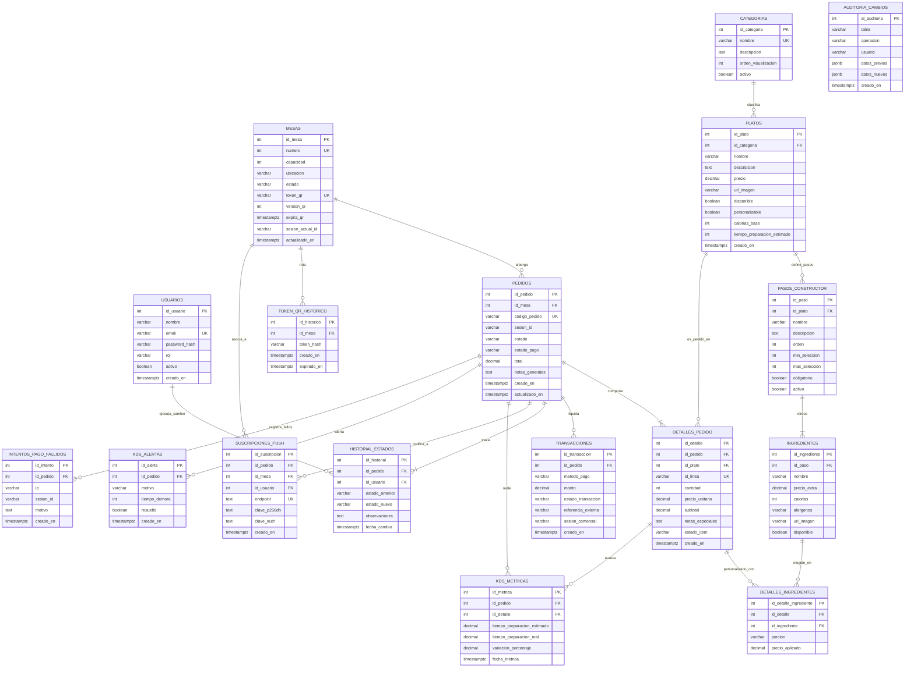

# 📊 Modelo Entidad-Relación (MER) y Diagrama ER (DER) - SmartDining

**Proyecto:** SmartDining - Plataforma Web para Digitalización de Sala y Cocina  
**Módulo:** Base de Datos Relacional (PostgreSQL 15+/16)  
**Autor y Líder de Datos:** Jarrinson Pulgarin  
**Nivel de Normalización:** Tercera Forma Normal (3FN) con Extensiones Analíticas  

---

## 🎯 1. Análisis de Requerimientos y Decisiones de Arquitectura

El diseño relacional de **SmartDining** responde a los flujos críticos de la operación en tiempo real en salones de comida y cocinas de alta demanda:

1. **Inmutabilidad y Auditoría Financiera:**  
   En `detalles_pedido`, el atributo `precio_unitario` se almacena como una copia congelada al momento de la orden. Asimismo, en `detalles_ingredientes`, el atributo `precio_aplicado` congela el recargo por porción extra del ingrediente seleccionado. Si el restaurante incrementa los precios en la carta al día siguiente, los registros contables históricos y los cierres de caja previos permanecen inmutables.
2. **Ciclo de Vida del Pedido y Pantallas KDS:**  
   Los estados del pedido (`recibido` ➔ `en_preparacion` ➔ `listo` ➔ `entregado` ➔ `pagado` ➔ `cancelado`) se auditan de forma inmutable en `historial_estados`. Para evaluar la eficiencia operativa de cocina, la tabla `kds_metricas` compara el tiempo de preparación contractual (`tiempo_preparacion_estimado`) contra el tiempo real de despacho en pantalla KDS (`tiempo_preparacion_real`), calculando la desviación porcentual.
3. **Platos Personalizables ("Constructor de Platos"):**  
   El modelo desacopla la definición del menú clásico de los platos configurables (ej. "Arma tu bowl", "Arma tu hamburguesa"). La jerarquía `platos` ➔ `pasos_constructor` ➔ `ingredientes` modela pasos secuenciales con reglas de selección mínima y máxima (`min_seleccion`, `max_seleccion`, `obligatorio`), mientras que `detalles_ingredientes` registra la elección del comensal y el tamaño de porción (`normal`, `extra`, `ligera`).
4. **Control de Mesas y Rotación Segura de Códigos QR:**  
   Cada mesa física cuenta con un `token_qr` criptográficamente seguro, una marca de expiración (`expira_qr`) y un contador de versión (`version_qr`). La tabla `token_qr_historico` almacena los hashes de tokens previos, impidiendo el uso de códigos QR desactualizados o fotografías tomadas por terceros fuera del establecimiento.
5. **Pagos Mixtos, Parciales e Idempotencia:**  
   La tabla `transacciones` soporta cobros divididos entre múltiples comensales o métodos combinados (efectivo, tarjeta, transferencia bancaria). Se valida la consistencia con el campo `estado_pago` de la cabecera `pedidos`, y la tabla `intentos_pago_fallidos` protege contra ataques de fuerza bruta o anomalías repetitivas (mitigación de seguridad H-08).

---

## 📐 2. Modelo Conceptual (MER): Entidades y Cardinalidades

- **`USUARIOS` (1) ──── (0..N) `HISTORIAL_ESTADOS`:** Un usuario del personal registra transiciones en los pedidos.
- **`MESAS` (1) ──── (0..N) `PEDIDOS`:** Una mesa alberga múltiples pedidos en el tiempo (uno solo activo en simultáneo).
- **`MESAS` (1) ──── (0..N) `TOKEN_QR_HISTORICO`:** Una mesa rota su código QR generando registros históricos.
- **`CATEGORIAS` (1) ──── (0..N) `PLATOS`:** Una categoría agrupa múltiples platos del catálogo.
- **`PLATOS` (1) ──── (0..N) `PASOS_CONSTRUCTOR`:** Un plato personalizable define sus pasos de armado.
- **`PASOS_CONSTRUCTOR` (1) ──── (1..N) `INGREDIENTES`:** Cada paso ofrece un abanico de ingredientes seleccionables.
- **`PEDIDOS` (1) ──── (1..N) `DETALLES_PEDIDO`:** Un pedido contiene uno o más ítems solicitados.
- **`PLATOS` (1) ──── (0..N) `DETALLES_PEDIDO`:** Un plato puede solicitarse en múltiples pedidos.
- **`DETALLES_PEDIDO` (1) ──── (0..N) `DETALLES_INGREDIENTES`:** Un ítem de plato armado desglosa sus ingredientes elegidos.
- **`INGREDIENTES` (1) ──── (0..N) `DETALLES_INGREDIENTES`:** Un ingrediente se referencia en las elecciones del comensal.
- **`PEDIDOS` (1) ──── (0..N) `TRANSACCIONES`:** Un pedido se liquida mediante una o varias transacciones.
- **`PEDIDOS` (1) ──── (1..N) `HISTORIAL_ESTADOS`:** Todo pedido tiene una cronología estricta de cambios de estado.
- **`PEDIDOS` (0..1) ──── (0..N) `SUSCRIPCIONES_PUSH`:** Dispositivos comensales y personal suscritos a notificaciones Push.
- **`PEDIDOS` (1) ──── (0..N) `KDS_METRICAS`:** Cada pedido y detalle genera métricas de tiempo en cocina.
- **`PEDIDOS` (0..1) ──── (0..N) `KDS_ALERTAS`:** Pedidos demorados en cocina disparan alertas de semaforización.
- **`PEDIDOS` (0..1) ──── (0..N) `INTENTOS_PAGO_FALLIDOS`:** Transacciones rechazadas o fallidas quedan registradas para prevención de fraude.

---

## 🗂️ 3. Diagrama Físico Entidad-Relación (DER en Mermaid)

---

## 📖 4. Diccionario de Datos Exhaustivo (17 Tablas)

### 1. `usuarios`
Cuentas del personal administrativo y operativo del restaurante.

| Campo | Tipo PostgreSQL | Nulo | Restricciones / Default | Descripción |
| :--- | :--- | :--- | :--- | :--- |
| `id_usuario` | `SERIAL` | NO | PRIMARY KEY | Identificador único del usuario. |
| `nombre` | `VARCHAR(100)` | NO | - | Nombre completo del colaborador. |
| `email` | `VARCHAR(120)` | NO | UNIQUE | Correo electrónico de inicio de sesión. |
| `password_hash` | `VARCHAR(255)` | NO | - | Hash bcrypt/argon2 con salt. |
| `rol` | `VARCHAR(20)` | NO | CHECK (`rol` IN ('admin', 'mesero', 'cajero', 'cocina')) | Rol para control RBAC. |
| `activo` | `BOOLEAN` | NO | DEFAULT `TRUE` | Estado de acceso (H-09). |
| `creado_en` | `TIMESTAMPTZ` | NO | DEFAULT `CURRENT_TIMESTAMP` | Fecha de alta en el sistema. |

---

### 2. `mesas`
Mesas físicas en el salón y configuración de códigos QR rotativos.

| Campo | Tipo PostgreSQL | Nulo | Restricciones / Default | Descripción |
| :--- | :--- | :--- | :--- | :--- |
| `id_mesa` | `SERIAL` | NO | PRIMARY KEY | Identificador único interno. |
| `numero` | `INTEGER` | NO | UNIQUE, CHECK (`numero` > 0) | Número visible en la mesa física. |
| `capacidad` | `INTEGER` | NO | DEFAULT 4, CHECK (`capacidad` > 0) | Aforo de comensales. |
| `ubicacion` | `VARCHAR(50)` | SÍ | DEFAULT 'Principal' | Zona del establecimiento (Terraza, Salón, Barra). |
| `estado` | `VARCHAR(20)` | NO | DEFAULT 'disponible', CHECK (`estado` IN ('disponible', 'ocupada', 'reservada', 'mantenimiento')) | Estado operativo actual. |
| `token_qr` | `VARCHAR(255)` | NO | UNIQUE | Token aleatorio firmado del código QR. |
| `version_qr` | `INTEGER` | NO | DEFAULT 1 | Contador incremental de rotación de QR. |
| `expira_qr` | `TIMESTAMPTZ` | SÍ | - | Marca de expiración automática del código QR. |
| `sesion_actual_id`| `VARCHAR(100)` | SÍ | - | Identificador de la sesión de mesa activa. |
| `actualizado_en` | `TIMESTAMPTZ` | NO | DEFAULT `CURRENT_TIMESTAMP` | Fecha de última modificación. |

---

### 3. `token_qr_historico`
Auditoría y revocación de códigos QR rotados para prevenir accesos fraudulentos.

| Campo | Tipo PostgreSQL | Nulo | Restricciones / Default | Descripción |
| :--- | :--- | :--- | :--- | :--- |
| `id_historico` | `SERIAL` | NO | PRIMARY KEY | Identificador único del registro. |
| `id_mesa` | `INTEGER` | NO | FOREIGN KEY &rarr; `mesas(id_mesa)` ON DELETE CASCADE | Mesa a la que pertenecía el token. |
| `token_hash` | `VARCHAR(64)` | NO | - | Hash SHA-256 del token invalidado. |
| `creado_en` | `TIMESTAMPTZ` | NO | DEFAULT `CURRENT_TIMESTAMP` | Fecha de emisión original. |
| `expirado_en` | `TIMESTAMPTZ` | NO | DEFAULT `CURRENT_TIMESTAMP` | Fecha de revocación o rotación. |

---

### 4. `categorias`
Clasificación de productos del menú comercial.

| Campo | Tipo PostgreSQL | Nulo | Restricciones / Default | Descripción |
| :--- | :--- | :--- | :--- | :--- |
| `id_categoria` | `SERIAL` | NO | PRIMARY KEY | Identificador de la categoría. |
| `nombre` | `VARCHAR(60)` | NO | UNIQUE | Nombre visible en la carta (ej. Hamburguesas). |
| `descripcion` | `TEXT` | SÍ | - | Descripción complementaria. |
| `orden_visualizacion` | `INTEGER` | NO | DEFAULT 0 | Orden de despliegue en pestañas del frontend. |
| `activo` | `BOOLEAN` | NO | DEFAULT `TRUE` | Bandera de visibilidad comercial. |

---

### 5. `platos`
Catálogo de platos convencionales y personalizables.

| Campo | Tipo PostgreSQL | Nulo | Restricciones / Default | Descripción |
| :--- | :--- | :--- | :--- | :--- |
| `id_plato` | `SERIAL` | NO | PRIMARY KEY | Identificador único del plato. |
| `id_categoria` | `INTEGER` | NO | FOREIGN KEY &rarr; `categorias(id_categoria)` | Categoría asignada. |
| `nombre` | `VARCHAR(120)` | NO | - | Nombre del plato. |
| `descripcion` | `TEXT` | SÍ | - | Descripción detallada de ingredientes e historia. |
| `precio` | `DECIMAL(10,2)` | NO | CHECK (`precio` >= 0) | Precio base en moneda local. |
| `url_imagen` | `VARCHAR(255)` | SÍ | - | Enlace a la imagen optimizada del plato. |
| `disponible` | `BOOLEAN` | NO | DEFAULT `TRUE` | Disponibilidad en cocina (RF-11). |
| `personalizable`| `BOOLEAN` | NO | DEFAULT `FALSE` | Habilita el flujo de constructor de platos. |
| `calorias_base` | `INTEGER` | SÍ | CHECK (`calorias_base` >= 0) | Conteo calórico estándar. |
| `tiempo_preparacion_estimado` | `INTEGER` | NO | DEFAULT 15, CHECK (`tiempo` > 0) | Tiempo objetivo de preparación en minutos (KDS). |
| `creado_en` | `TIMESTAMPTZ` | NO | DEFAULT `CURRENT_TIMESTAMP` | Fecha de creación del registro. |

---

### 6. `pasos_constructor`
Etapas secuenciales de configuración de un plato personalizable.

| Campo | Tipo PostgreSQL | Nulo | Restricciones / Default | Descripción |
| :--- | :--- | :--- | :--- | :--- |
| `id_paso` | `SERIAL` | NO | PRIMARY KEY | Identificador único del paso. |
| `id_plato` | `INTEGER` | NO | FOREIGN KEY &rarr; `platos(id_plato)` ON DELETE CASCADE | Plato personalizable al que pertenece. |
| `nombre` | `VARCHAR(100)` | NO | - | Título del paso (ej. "Elige tu Proteína"). |
| `descripcion` | `TEXT` | SÍ | - | Instrucción para el comensal. |
| `orden` | `INTEGER` | NO | DEFAULT 1, CHECK (`orden` > 0) | Posición en el flujo guiado. |
| `min_seleccion`| `INTEGER` | NO | DEFAULT 1, CHECK (`min_seleccion` >= 0) | Mínimo de opciones obligatorias. |
| `max_seleccion`| `INTEGER` | NO | DEFAULT 1, CHECK (`max_seleccion` >= `min_seleccion`) | Máximo de opciones permitidas. |
| `obligatorio` | `BOOLEAN` | NO | DEFAULT `TRUE` | Exige seleccionar al menos una opción para avanzar. |
| `activo` | `BOOLEAN` | NO | DEFAULT `TRUE` | Permite deshabilitar temporalmente el paso. |

---

### 7. `ingredientes`
Opciones disponibles dentro de cada paso del constructor de platos.

| Campo | Tipo PostgreSQL | Nulo | Restricciones / Default | Descripción |
| :--- | :--- | :--- | :--- | :--- |
| `id_ingrediente`| `SERIAL` | NO | PRIMARY KEY | Identificador único del ingrediente. |
| `id_paso` | `INTEGER` | NO | FOREIGN KEY &rarr; `pasos_constructor(id_paso)` ON DELETE CASCADE | Paso al que pertenece. |
| `nombre` | `VARCHAR(100)` | NO | - | Nombre del ingrediente (ej. "Carne Angus 150g"). |
| `precio_extra` | `DECIMAL(10,2)` | NO | DEFAULT 0.00, CHECK (`precio_extra` >= 0) | Costo adicional por porción. |
| `calorias` | `INTEGER` | SÍ | DEFAULT 0, CHECK (`calorias` >= 0) | Aporte calórico de la porción. |
| `alergenos` | `VARCHAR(255)` | SÍ | - | Lista de alérgenos (gluten, lactosa, etc.). |
| `url_imagen` | `VARCHAR(255)` | SÍ | - | Enlace al thumbnail representativo. |
| `disponible` | `BOOLEAN` | NO | DEFAULT `TRUE` | Stock en cocina para selección. |

---

### 8. `pedidos`
Cabecera transaccional de comanda emitida por mesa o personal.

| Campo | Tipo PostgreSQL | Nulo | Restricciones / Default | Descripción |
| :--- | :--- | :--- | :--- | :--- |
| `id_pedido` | `SERIAL` | NO | PRIMARY KEY | Identificador numérico secuencial. |
| `id_mesa` | `INTEGER` | NO | FOREIGN KEY &rarr; `mesas(id_mesa)` | Mesa donde se origina la orden. |
| `codigo_pedido`| `VARCHAR(20)` | NO | UNIQUE | Código alfanumérico público (ej. ORD-2026-0042). |
| `sesion_id` | `VARCHAR(100)` | SÍ | - | Identificador de sesión JWT del comensal. |
| `estado` | `VARCHAR(25)` | NO | DEFAULT 'recibido', CHECK (`estado` IN ('recibido', 'en_preparacion', 'listo', 'entregado', 'pagado', 'cancelado')) | Estado operativo en el flujo del restaurante. |
| `estado_pago` | `VARCHAR(20)` | NO | DEFAULT 'pendiente', CHECK (`estado_pago` IN ('pendiente', 'parcial', 'pagado', 'reembolsado')) | Estado financiero de liquidación (H-03). |
| `total` | `DECIMAL(10,2)` | NO | DEFAULT 0.00, CHECK (`total` >= 0) | Monto total acumulado de la comanda. |
| `notas_generales` | `TEXT` | SÍ | - | Comentarios generales sobre la orden. |
| `creado_en` | `TIMESTAMPTZ` | NO | DEFAULT `CURRENT_TIMESTAMP` | Marca temporal de emisión. |
| `actualizado_en` | `TIMESTAMPTZ` | NO | DEFAULT `CURRENT_TIMESTAMP` | Marca temporal de última modificación. |

---

### 9. `detalles_pedido`
Líneas de comanda individuales con cantidad y precio congelado.

| Campo | Tipo PostgreSQL | Nulo | Restricciones / Default | Descripción |
| :--- | :--- | :--- | :--- | :--- |
| `id_detalle` | `SERIAL` | NO | PRIMARY KEY | Identificador de línea. |
| `id_pedido` | `INTEGER` | NO | FOREIGN KEY &rarr; `pedidos(id_pedido)` ON DELETE CASCADE | Pedido al que pertenece. |
| `id_plato` | `INTEGER` | NO | FOREIGN KEY &rarr; `platos(id_plato)` | Plato solicitado. |
| `id_linea` | `VARCHAR(50)` | SÍ | - | Identificador único de línea para KDS y sockets. |
| `cantidad` | `INTEGER` | NO | DEFAULT 1, CHECK (`cantidad` > 0) | Unidades ordenadas. |
| `precio_unitario` | `DECIMAL(10,2)` | NO | CHECK (`precio_unitario` >= 0) | Precio unitario congelado al ordenar. |
| `subtotal` | `DECIMAL(10,2)` | NO | CHECK (`subtotal` >= 0) | Subtotal congelado (`cantidad * (precio_unitario + extras)`). |
| `notas_especiales`| `TEXT` | SÍ | - | Instrucciones de cocina específicas. |
| `estado_item` | `VARCHAR(20)` | NO | DEFAULT 'pendiente', CHECK (`estado_item` IN ('pendiente', 'cocinando', 'listo', 'despachado')) | Estado de preparación individual en KDS. |
| `creado_en` | `TIMESTAMPTZ` | NO | DEFAULT `CURRENT_TIMESTAMP` | Marca temporal de registro. |

---

### 10. `detalles_ingredientes`
Personalización atómica de ingredientes para platos del constructor.

| Campo | Tipo PostgreSQL | Nulo | Restricciones / Default | Descripción |
| :--- | :--- | :--- | :--- | :--- |
| `id_detalle_ingrediente` | `SERIAL` | NO | PRIMARY KEY | Identificador único. |
| `id_detalle` | `INTEGER` | NO | FOREIGN KEY &rarr; `detalles_pedido(id_detalle)` ON DELETE CASCADE | Ítem de la orden asociado. |
| `id_ingrediente` | `INTEGER` | NO | FOREIGN KEY &rarr; `ingredientes(id_ingrediente)` | Ingrediente seleccionado. |
| `porcion` | `VARCHAR(20)` | NO | DEFAULT 'normal', CHECK (`porcion` IN ('normal', 'extra', 'ligera')) | Tamaño de porción seleccionada. |
| `precio_aplicado` | `DECIMAL(10,2)` | NO | DEFAULT 0.00, CHECK (`precio_aplicado` >= 0) | Recargo extra congelado aplicado a la orden. |

---

### 11. `transacciones`
Movimientos financieros de pago y conciliación.

| Campo | Tipo PostgreSQL | Nulo | Restricciones / Default | Descripción |
| :--- | :--- | :--- | :--- | :--- |
| `id_transaccion`| `SERIAL` | NO | PRIMARY KEY | Identificador de transacción. |
| `id_pedido` | `INTEGER` | NO | FOREIGN KEY &rarr; `pedidos(id_pedido)` | Pedido liquidado. |
| `metodo_pago` | `VARCHAR(20)` | NO | CHECK (`metodo_pago` IN ('efectivo', 'tarjeta', 'transferencia', 'otro')) | Medio de pago utilizado. |
| `monto` | `DECIMAL(10,2)` | NO | CHECK (`monto` > 0) | Valor pagado en la transacción. |
| `estado_transaccion` | `VARCHAR(20)`| NO | DEFAULT 'completada', CHECK (`estado_transaccion` IN ('pendiente', 'completada', 'fallida', 'revertida')) | Estado de conciliación (H-07). |
| `referencia_externa` | `VARCHAR(100)`| SÍ | - | Código de voucher o comprobante de pasarela. |
| `sesion_comensal`| `VARCHAR(100)` | SÍ | - | Identificador del comensal que efectuó el pago parcial. |
| `creado_en` | `TIMESTAMPTZ` | NO | DEFAULT `CURRENT_TIMESTAMP` | Marca temporal del pago. |

---

### 12. `historial_estados`
Auditoría inmutable del ciclo de vida de los pedidos.

| Campo | Tipo PostgreSQL | Nulo | Restricciones / Default | Descripción |
| :--- | :--- | :--- | :--- | :--- |
| `id_historial` | `SERIAL` | NO | PRIMARY KEY | Identificador de evento. |
| `id_pedido` | `INTEGER` | NO | FOREIGN KEY &rarr; `pedidos(id_pedido)` ON DELETE CASCADE | Pedido auditado. |
| `id_usuario` | `INTEGER` | SÍ | FOREIGN KEY &rarr; `usuarios(id_usuario)` ON DELETE SET NULL | Colaborador responsable de la acción. |
| `estado_anterior`| `VARCHAR(25)` | SÍ | - | Estado antes de la transición. |
| `estado_nuevo` | `VARCHAR(25)` | NO | - | Estado resultante tras la transición. |
| `observaciones`| `TEXT` | SÍ | - | Motivo del cambio o notas adicionales. |
| `fecha_cambio` | `TIMESTAMPTZ` | NO | DEFAULT `CURRENT_TIMESTAMP` | Timestamp exacto de la transición. |

---

### 13. `suscripciones_push`
Credenciales para notificaciones Web Push PWA (W3C Push API).

| Campo | Tipo PostgreSQL | Nulo | Restricciones / Default | Descripción |
| :--- | :--- | :--- | :--- | :--- |
| `id_suscripcion`| `SERIAL` | NO | PRIMARY KEY | Identificador de suscripción. |
| `id_pedido` | `INTEGER` | SÍ | FOREIGN KEY &rarr; `pedidos(id_pedido)` ON DELETE CASCADE | Pedido monitoreado por el cliente. |
| `id_mesa` | `INTEGER` | SÍ | FOREIGN KEY &rarr; `mesas(id_mesa)` ON DELETE CASCADE | Mesa asignada al dispositivo. |
| `id_usuario` | `INTEGER` | SÍ | FOREIGN KEY &rarr; `usuarios(id_usuario)` ON DELETE CASCADE | Usuario de personal para alertas. |
| `endpoint` | `TEXT` | NO | UNIQUE | URL única del servicio push del navegador. |
| `clave_p256dh` | `TEXT` | NO | - | Clave pública del cliente para cifrado ECDH. |
| `clave_auth` | `TEXT` | NO | - | Secreto de autenticación del cliente. |
| `creado_en` | `TIMESTAMPTZ` | NO | DEFAULT `CURRENT_TIMESTAMP` | Fecha de suscripción. |

---

### 14. `kds_metricas`
Métricas de rendimiento y tiempos reales de preparación en cocina.

| Campo | Tipo PostgreSQL | Nulo | Restricciones / Default | Descripción |
| :--- | :--- | :--- | :--- | :--- |
| `id_metrica` | `SERIAL` | NO | PRIMARY KEY | Identificador de la métrica. |
| `id_pedido` | `INTEGER` | NO | FOREIGN KEY &rarr; `pedidos(id_pedido)` ON DELETE CASCADE | Comanda evaluada. |
| `id_detalle` | `INTEGER` | SÍ | FOREIGN KEY &rarr; `detalles_pedido(id_detalle)` ON DELETE SET NULL | Ítem específico analizado. |
| `tiempo_preparacion_estimado` | `DECIMAL(5,1)` | NO | - | Meta contractual en minutos. |
| `tiempo_preparacion_real` | `DECIMAL(5,1)` | NO | - | Minutos reales registrados en KDS. |
| `variacion_porcentaje` | `DECIMAL(5,2)` | NO | - | Desviación calculada (`((real - est) / est) * 100`). |
| `fecha_metrica` | `TIMESTAMPTZ` | NO | DEFAULT `CURRENT_TIMESTAMP` | Timestamp del despacho del plato. |

---

### 15. `kds_alertas`
Alertas automáticas por demoras excesivas en cocina.

| Campo | Tipo PostgreSQL | Nulo | Restricciones / Default | Descripción |
| :--- | :--- | :--- | :--- | :--- |
| `id_alerta` | `SERIAL` | NO | PRIMARY KEY | Identificador de alerta. |
| `id_pedido` | `INTEGER` | NO | FOREIGN KEY &rarr; `pedidos(id_pedido)` ON DELETE CASCADE | Pedido demorado. |
| `motivo` | `VARCHAR(100)` | NO | - | Causa de la alerta (ej. "Demora crítica > 20 min"). |
| `tiempo_demora`| `INTEGER` | NO | CHECK (`tiempo_demora` >= 0) | Minutos de retraso sobre la estimación. |
| `resuelto` | `BOOLEAN` | NO | DEFAULT `FALSE` | Marca de atención por el jefe de cocina. |
| `creado_en` | `TIMESTAMPTZ` | NO | DEFAULT `CURRENT_TIMESTAMP` | Fecha y hora de disparo de la alerta. |

---

### 16. `intentos_pago_fallidos`
Prevención de fraude y ataques de fuerza bruta en pasarelas de pago (H-08).

| Campo | Tipo PostgreSQL | Nulo | Restricciones / Default | Descripción |
| :--- | :--- | :--- | :--- | :--- |
| `id_intento` | `SERIAL` | NO | PRIMARY KEY | Identificador del intento fallido. |
| `id_pedido` | `INTEGER` | SÍ | FOREIGN KEY &rarr; `pedidos(id_pedido)` ON DELETE SET NULL | Comanda asociada. |
| `ip` | `VARCHAR(45)` | NO | - | Dirección IPv4 o IPv6 del cliente. |
| `sesion_id` | `VARCHAR(100)` | SÍ | - | Identificador de sesión comensal. |
| `motivo` | `TEXT` | NO | - | Razón técnica del rechazo del pago. |
| `creado_en` | `TIMESTAMPTZ` | NO | DEFAULT `CURRENT_TIMESTAMP` | Marca temporal del evento. |

---

### 17. `auditoria_cambios`
Bitácora general de modificaciones en datos sensibles (CDC).

| Campo | Tipo PostgreSQL | Nulo | Restricciones / Default | Descripción |
| :--- | :--- | :--- | :--- | :--- |
| `id_auditoria` | `SERIAL` | NO | PRIMARY KEY | Identificador de auditoría. |
| `tabla` | `VARCHAR(50)` | NO | - | Tabla modificada (ej. `platos`, `usuarios`). |
| `operacion` | `VARCHAR(10)` | NO | CHECK (`operacion` IN ('INSERT', 'UPDATE', 'DELETE')) | Operación DML efectuada. |
| `usuario` | `VARCHAR(100)` | SÍ | - | Identidad del ejecutor en sesión o base de datos. |
| `datos_previos`| `JSONB` | SÍ | - | Snapshot antes de la modificación. |
| `datos_nuevos` | `JSONB` | SÍ | - | Snapshot resultante tras la modificación. |
| `creado_en` | `TIMESTAMPTZ` | NO | DEFAULT `CURRENT_TIMESTAMP` | Marca temporal de la operación. |

---

## 📈 5. Vistas Analíticas del Sistema

1. **`v_ventas_diarias`:**
   Consolida por fecha el volumen de ventas, pedidos liquidados, total recaudado, ticket promedio y cantidad de ítems vendidos. Excluye pedidos cancelados.
2. **`v_ingredientes_top`:**
   Evalúa la demanda de ingredientes del constructor, distinguiendo solicitudes estándar de porciones extras y calculando ingresos generados por recargos.
3. **`v_platos_top`:**
   Mide la popularidad y rentabilidad por plato del catálogo tradicional.
4. **`v_tiempos_kds`:**
   Sintetiza la eficiencia del equipo de cocina comparando tiempos estimados contra tiempos reales de entrega.
5. **`v_pedidos_activos`:**
   Monitorea en tiempo real todas las comandas en preparación y listas en el salón.
6. **`v_mesas_ocupacion`:**
   Visualiza el estado de las mesas físicas y el tiempo transcurrido desde su apertura.

---

## 🛡️ 6. Triggers y Procedimientos Almacenados Destacados

- **Recálculo Automático del Total de Pedido:**  
  Un trigger sobre `detalles_pedido` recalcula de forma atómica el campo `total` en `pedidos` ante inserciones, actualizaciones de cantidad o eliminaciones de líneas.
- **Sincronización del Estado de Pago (`estado_pago`):**  
  Al registrar transacciones completadas, la función `fn_actualizar_estado_pago` evalúa la suma de pagos contra el total de la comanda, transicionando automáticamente a `parcial` o `pagado`.
- **Rotación Criptográfica de Tokens QR:**  
  La función `fn_rotar_token_qr_mesa(p_id_mesa)` almacena el hash del token previo en `token_qr_historico`, genera un nuevo token criptográfico, incrementa `version_qr` y actualiza la mesa física.
