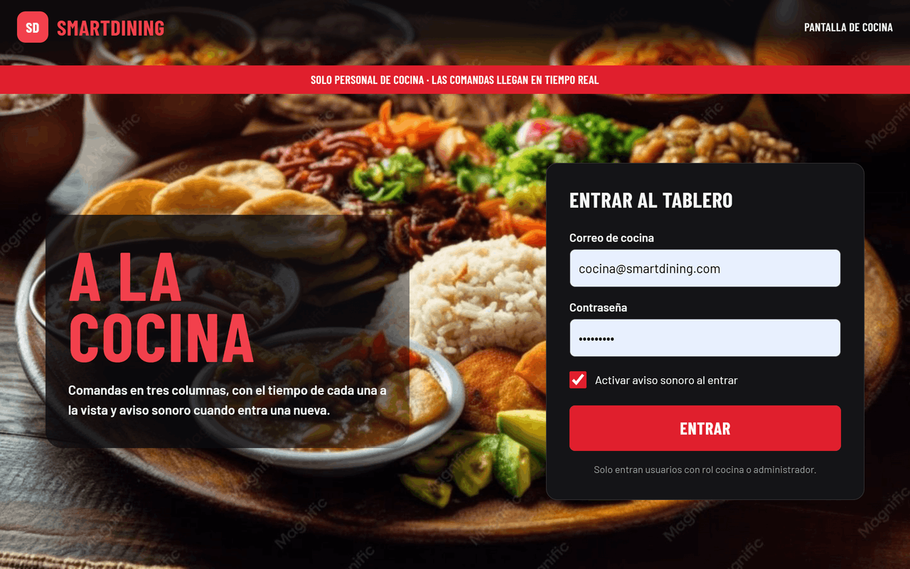
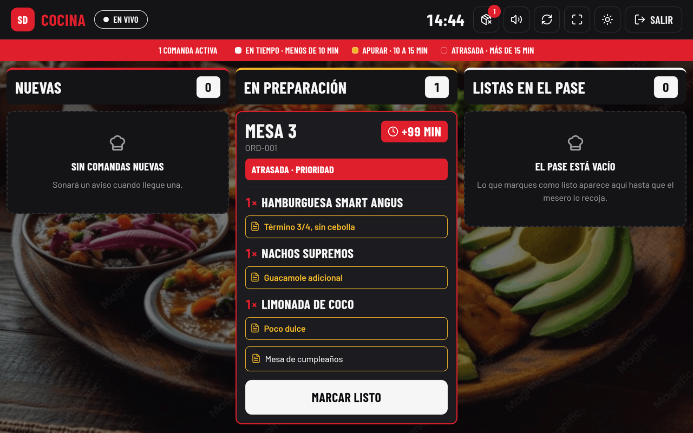
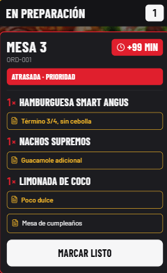
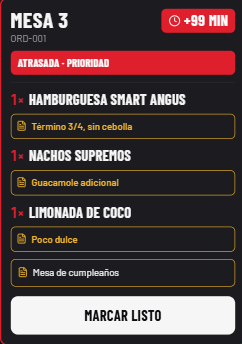
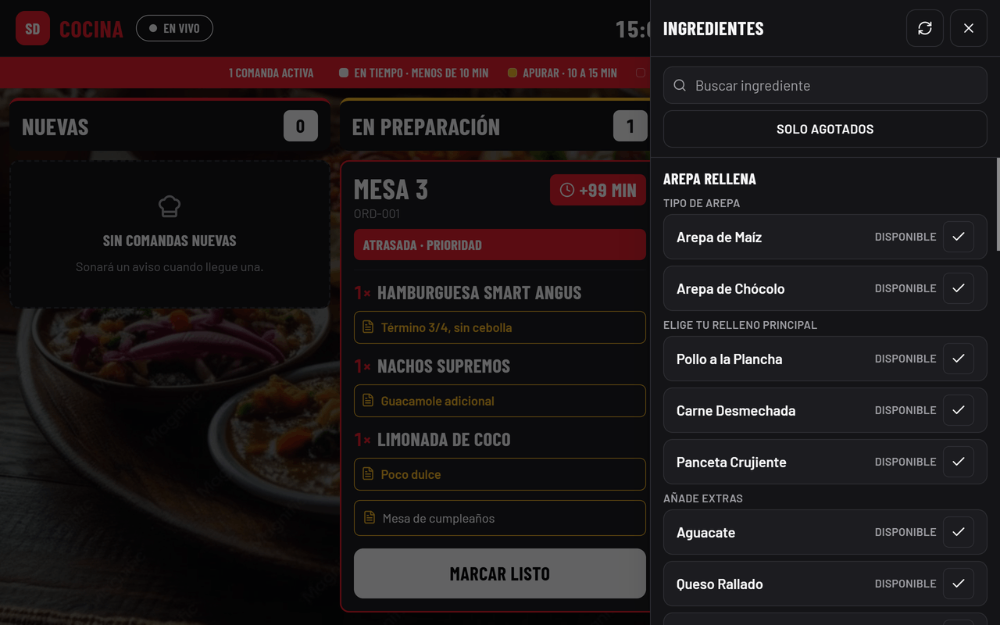
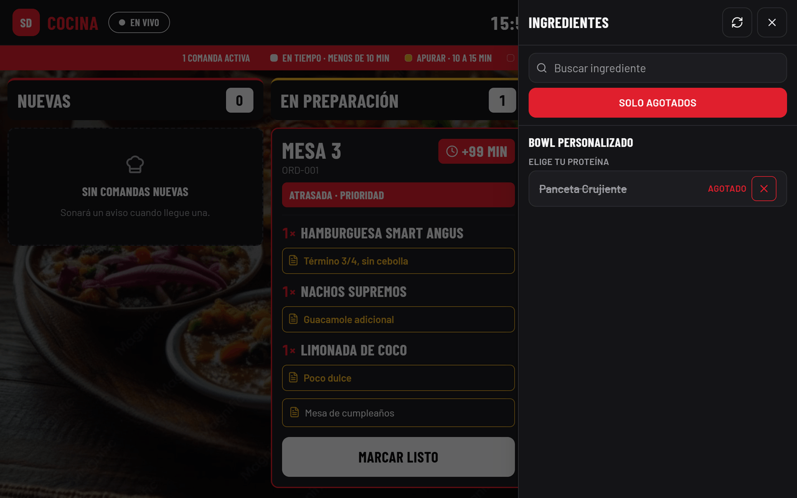
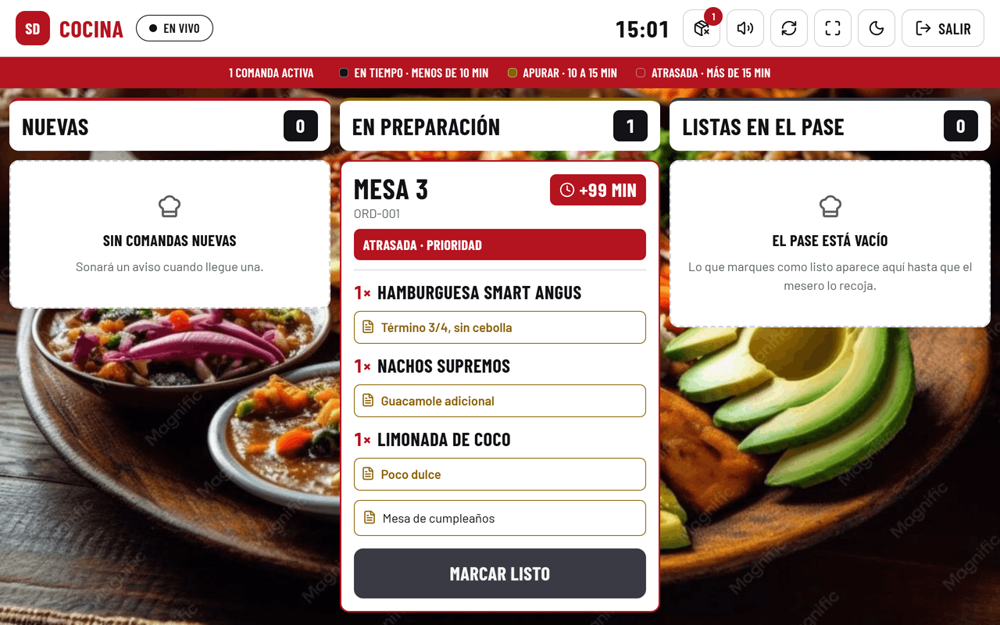
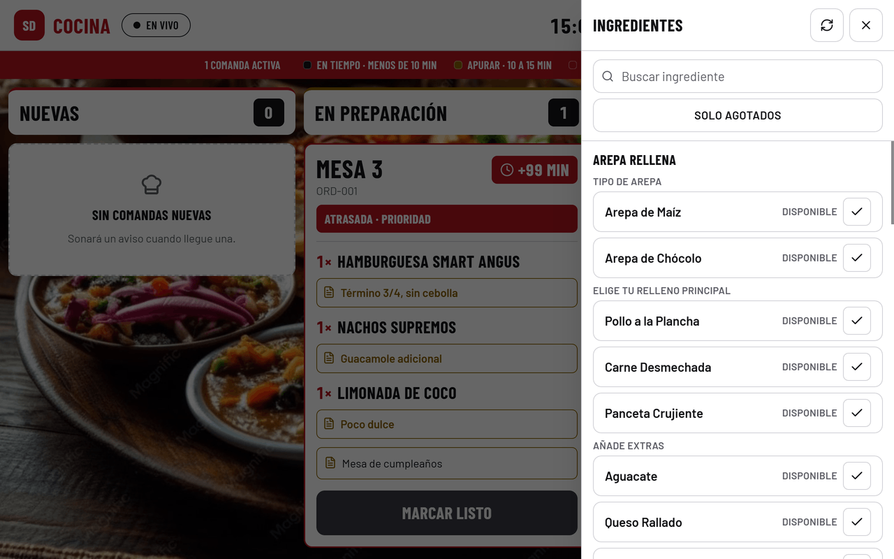
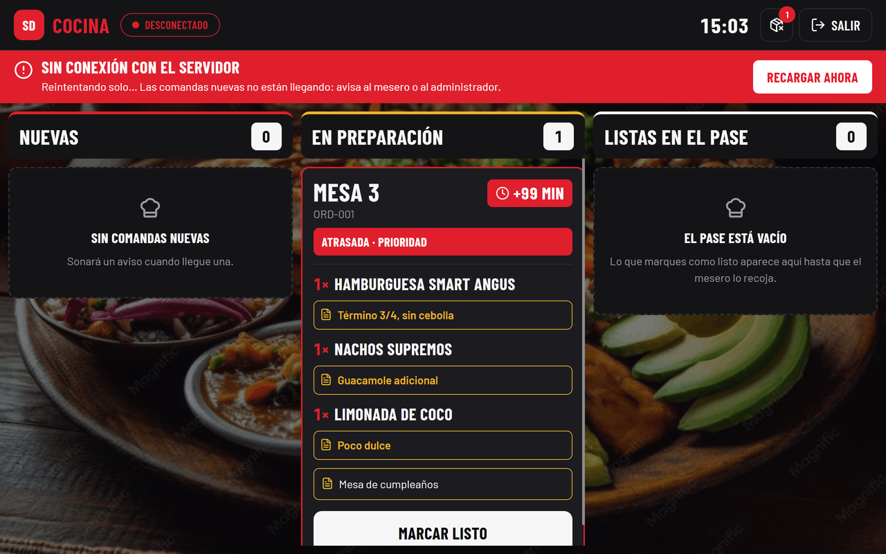

# Manual de la Pantalla de Cocina

## 1. Para qué sirve esta pantalla

Aquí llegan los pedidos de las mesas, uno detrás de otro.

Tú haces dos cosas: dices cuándo empiezas un pedido y dices cuándo está listo.
Nada más. Cobrar, cancelar y llevar los platos a la mesa lo hacen otros.

La pantalla se actualiza sola. No tienes que recargar nada.

---

## 2. Antes de empezar

### 2.1 Entrar

Escribe el correo de cocina y la contraseña, y toca **Entrar**.

Debajo hay una casilla, **Activar aviso sonoro al entrar**, que viene marcada.
Déjala marcada: es lo que hace que suene un pitido cuando entra un pedido
nuevo. Si la quitas, puedes activar el sonido después desde el tablero.

### 2.2 Si te equivocas al entrar

- Si el correo o la contraseña están mal, la pantalla te lo dice y te deja
  intentarlo otra vez.
- Si tu usuario no es de cocina, sale el aviso **"Este usuario no tiene acceso
  a la cocina"**. Esa cuenta no sirve aquí aunque la contraseña sea correcta.
  Pide la cuenta de cocina al administrador.
- Si lo intentas muchas veces seguidas con la contraseña mal, sale
  **"Demasiados intentos de inicio de sesión. Espera un momento y vuelve a
  intentarlo."**. Es una protección: espera un minuto y prueba otra vez.

### 2.3 Cerrar sesión al terminar el turno

Arriba a la derecha está el botón **Salir**. Úsalo al acabar.

Esta pantalla es compartida, así que la sesión no debe quedar abierta para el
turno siguiente. Si cierras el navegador, la sesión también se cierra sola.

---

## 3. Las tres columnas

El tablero tiene tres columnas. Un pedido entra por la izquierda y avanza hacia
la derecha. Cada columna lleva al lado un número: cuántos pedidos tiene.

### 3.1 Nuevas — lo que acaba de entrar

Lo que el mesero o el cliente acaban de pedir y nadie ha tocado todavía.

Cuando está vacía dice **"Sin comandas nuevas"**.

### 3.2 En preparación — lo que estás cocinando

Lo que ya empezaste. Aquí está tu trabajo de ahora.

Cuando está vacía dice **"Nada en preparación"**.

### 3.3 Listas en el pase — lo que espera al mesero

Lo que terminaste y está en el pase esperando a que se lo lleven.

Cuando está vacía dice **"El pase está vacío"**.

En las dos primeras columnas, lo más viejo va arriba: lo de arriba es lo que
toca atender primero. En el pase es al revés, arriba va lo que acaba de salir.

---

## 4. Cómo se lee una comanda

Cada tarjeta es un pedido. De arriba abajo:

### 4.1 La mesa y el número

Arriba, grande: **Mesa 3**. Es a dónde va el pedido.

Debajo, más pequeño, va el número del pedido (por ejemplo `ORD-001`). Sirve
para nombrarlo si tienes que preguntarle algo al mesero.

### 4.2 Los platos y las cantidades

Cada línea empieza con la cantidad: **1×**, **2×**, y después el nombre del
plato.

### 4.3 Las notas

Debajo de cada plato, en recuadros, van las notas de quien pidió: "Término 3/4,
sin cebolla", "Guacamole adicional", "Poco dulce".

**Léelas siempre.** Son lo que cambia el plato. La última de la tarjeta puede
ser una nota de toda la mesa, como "Mesa de cumpleaños".

### 4.4 El reloj

Arriba a la derecha, el reloj dice cuántos minutos lleva el pedido esperando.

Si pasa de 99 minutos no muestra la cifra: pone **+99 min**. Lo que importa es
que lleva muchísimo.

---

## 5. Mover una comanda

### 5.1 Empezar a prepararla

En la columna **Nuevas**, cada tarjeta tiene abajo el botón **Empezar**.

Tócalo cuando te pongas con ese pedido. La tarjeta se va sola a *En
preparación*.

### 5.2 Marcarla lista

En **En preparación**, el botón de abajo dice **Marcar listo**.

Tócalo cuando el pedido esté terminado y puesto en el pase. La tarjeta se va a
*Listas en el pase* y el mesero se entera al instante.

### 5.3 Me equivoqué, ¿puedo volver atrás?

**No desde esta pantalla.** Los pedidos solo avanzan hacia adelante: de Nuevas
a En preparación, y de ahí al pase. No hay botón para retroceder.

Si marcaste algo listo por error, avisa al mesero o al administrador de una vez,
porque el aviso ya le llegó.

En la columna del pase las tarjetas no tienen botón: sacarlas del tablero lo
hace el mesero cuando se lleva el plato.

---

## 6. Los colores del reloj

Debajo de la cabecera hay una franja roja que recuerda los tres tiempos:

> **En tiempo · menos de 10 min** — **Apurar · 10 a 15 min** — **Atrasada · más de 15 min**

### 6.1 En tiempo (menos de 10 minutos)

El pedido va bien. No tienes que hacer nada especial.

### 6.2 Apurar (de 10 a 15 minutos)

El reloj se pone amarillo y la tarjeta dice **Apurar**.

Todavía estás a tiempo, pero este pedido pasa a ser el primero de tu lista.

### 6.3 Atrasada (más de 15 minutos)

El reloj se pone rojo y aparece una franja roja que dice
**ATRASADA · PRIORIDAD**.

### 6.4 Qué hacer cuando se pone rojo

1. Deja lo que estés haciendo y termina ese pedido primero.
2. Si no vas a poder en pocos minutos, avisa al mesero para que hable con la
   mesa.

Para que no te confundas: el color solo sale en **Nuevas** y **En preparación**,
que es donde el pedido depende de ti. En el pase la tarjeta muestra el tiempo
pero sin color ni aviso, porque ahí ya no es cosa de la cocina.

---

## 7. Cuando nadie recoge un plato del pase

En la columna del pase, el reloj no cuenta desde que se pidió, sino desde que
**tú lo marcaste listo**. Es el tiempo que el plato lleva esperando al mesero.

Cuando un plato lleva **más de 30 minutos** en el pase sin que nadie lo recoja,
la tarjeta avisa con un **Sin recoger**.

Si ves ese aviso, llama al mesero: ese plato ya se enfrió y hay que decidir qué
se hace con él.

---

## 8. Avisar que se acabó un ingrediente

Cuando se te acaba algo, lo marcas aquí y deja de poderse pedir al instante.
Así nadie pide algo que no tienes.

### 8.1 Abrir el panel

Arriba, a la izquierda del botón Salir, hay un botón con un icono de caja
tachada. Tócalo y se abre un panel lateral llamado **Ingredientes**.

Dentro está la carta entera, agrupada por plato y por paso. Cada fila es un
ingrediente con su estado al lado: **Disponible** o **Agotado**.

Si hay algo agotado, el botón de la cabecera lleva un número en rojo. Así sabes
si falta algo sin tener que abrir el panel.

### 8.2 Marcar algo como agotado

Toca la fila del ingrediente. Toda la fila funciona, no solo el icono, para que
puedas tocarla con guantes.

El estado cambia a **Agotado**, el nombre queda tachado y la fila se marca en
rojo. No te pregunta si estás seguro: en medio de un servicio eso estorba, y de
todos modos se deshace con otro toque.

En la foto está puesto además el filtro **Solo agotados**, por eso en la lista
solo se ve esa fila.

### 8.3 Reponerlo cuando vuelva

Toca otra vez la misma fila. Vuelve a **Disponible** y se puede pedir de nuevo.

### 8.4 Buscar un ingrediente

Arriba del panel hay una caja que dice **Buscar ingrediente**. Escribe parte del
nombre y la lista se reduce.

No hace falta poner tildes: escribiendo `jalapeno` encuentra `Jalapeño`.

### 8.5 Ver solo lo agotado

El botón **Solo agotados** deja en la lista únicamente lo que está apagado.

Es la vista para empezar el turno: abres, miras lo que quedó agotado ayer y
repones lo que ya tienes.

### 8.6 Qué pasa cuando marcas algo agotado

- Deja de poderse pedir de inmediato. Si alguien intenta pedirlo, el sistema no
  lo deja.
- El cliente lo ve al instante en su teléfono: el ingrediente deja de aparecer
  entre las opciones y, si ya lo tenía elegido, se le quita del pedido.
- Si hay otra pantalla de cocina abierta, también se actualiza sola.
- El panel del restaurante no se entera en el momento: lo verá la próxima vez
  que cargue la carta. Si necesitas que el mesero lo sepa ya, díselo.

El cambio se ve en tu pantalla antes de que el servidor conteste. Si algo
fallara, la fila vuelve a como estaba y te sale un mensaje debajo de **esa**
fila. Si ves ese mensaje, vuelve a tocar.

### 8.7 Lo que NO se marca aquí

- **Platos enteros, no.** Aquí solo se apagan ingredientes. Apagar un plato
  completo lo hace administración.
- **Si un plato está apagado, sus ingredientes no salen en el panel.** Esto
  importa: si no encuentras un ingrediente que juras que existe, puede ser que
  el plato entero esté apagado. Entonces no puedes reponerlo desde aquí y hay
  que pedírselo a administración.
- **Los pasos tampoco.** Lo que se apaga son las opciones, no la pregunta.

---

## 9. El sonido de aviso

Cuando entra un pedido nuevo suenan **dos pitidos cortos**.

Suena solo cuando el pedido entra de verdad en ese momento. No suena al
recargar la pantalla ni al recuperarse la conexión, para que no te sobresalte
sin motivo.

### 9.1 Encenderlo y apagarlo

Dos sitios:

- Al entrar, con la casilla **Activar aviso sonoro al entrar**.
- En cualquier momento, con el botón de la bocina en la cabecera. Si está
  encendido, al tocarlo lo silencias; si está apagado, lo enciendes.

La pantalla recuerda tu elección para la próxima vez.

Si el sonido no arranca al entrar, tócalo una vez desde el botón de la bocina:
algunos navegadores no dejan sonar nada hasta que tocas algo.

---

## 10. Cambiar entre pantalla oscura y clara

En la cabecera hay un botón con un sol (o una luna). Cada toque cambia entre
oscuro y claro.

La pantalla arranca en oscuro, que es lo normal en cocina. Si la cocina tiene
mucha luz, el claro se lee mejor. La pantalla recuerda cuál elegiste.

El panel de ingredientes cambia igual:

---

## 11. Cuando algo va mal

### 11.1 "Sin conexión con el servidor"

Si arriba se pone una franja roja que dice **"Sin conexión con el servidor"**,
la pantalla se quedó aislada. Debajo explica:

> Reintentando solo… Las comandas nuevas no están llegando: avisa al mesero o
> al administrador.

**Qué hacer:**

1. **Avisa al mesero de una vez.** Mientras tanto, los pedidos nuevos no te
   están llegando, aunque la pantalla se vea normal.
2. Toca **Recargar ahora**, en la misma franja roja.
3. Si no vuelve, avisa al administrador.

Mientras no hay conexión, arriba a la izquierda pone **Desconectado** en rojo y
desaparecen los botones de sonido, actualizar, pantalla completa y tema: con
todo parado no sirven de nada. Siguen el botón de ingredientes y el de Salir.

Marcar ingredientes agotados puede seguir funcionando, porque no depende de esa
conexión. Si falla, te saldrá un mensaje. Lo que no verás hasta que vuelva son
los cambios hechos desde otras pantallas.

### 11.2 La pantalla no se actualiza

Si arriba dice **En vivo** pero sospechas que falta algo, toca el botón de las
dos flechas en círculo de la cabecera: vuelve a pedir la lista completa.

Puede pasar que un pedido cambie de estado desde otra pantalla y aquí no
aparezca su tarjeta. Ese botón lo pone en su sitio.

### 11.3 Me sacó sola de la sesión

Si vuelves a la pantalla de entrar sin haber tocado Salir, es que tu sesión
caducó o alguien desactivó tu usuario. Entra otra vez. Si no te deja, avisa al
administrador.

### 11.4 Un botón no responde

Si tocas **Empezar** o **Marcar listo** y sale un mensaje de error en rojo
debajo del botón, vuelve a tocarlo. Si sigue fallando, avisa al administrador.

Si el botón se queda bloqueado, es porque además no hay conexión: se
desbloquea solo en cuanto vuelva.

### 11.5 A quién llamar

- **Un pedido mal, una nota rara, un plato que ya se llevaron:** al mesero.
- **La pantalla no entra, no carga o sigue sin conexión:** al administrador.

---

## 12. Resumen de una página

**Las tres columnas:** Nuevas → En preparación → Listas en el pase.

| Qué quieres hacer | Dónde | Qué tocas |
|---|---|---|
| Empezar un pedido | Nuevas | **Empezar** |
| Decir que está listo | En preparación | **Marcar listo** |
| Avisar que algo se acabó | Cabecera | Botón de la caja tachada |
| Encender o apagar el sonido | Cabecera | Botón de la bocina |
| Refrescar la lista | Cabecera | Botón de las dos flechas |
| Cambiar claro / oscuro | Cabecera | Botón del sol o la luna |
| Terminar el turno | Cabecera | **Salir** |

**El reloj de cada tarjeta:**

| Color | Tiempo | Qué significa |
|---|---|---|
| Normal | menos de 10 min | En tiempo, todo bien |
| Amarillo | de 10 a 15 min | Apurar: ponlo de primero |
| Rojo | más de 15 min | Atrasada: déjalo todo y termínalo |

El color solo sale en Nuevas y En preparación. Más de 99 minutos se muestra
como **+99 min**.

**En el pase:** si una tarjeta dice **Sin recoger**, lleva más de 30 minutos
esperando al mesero. Llámalo.

**Si sale la franja roja "Sin conexión con el servidor":** los pedidos nuevos no
están llegando. Avisa al mesero, toca **Recargar ahora** y, si no vuelve, llama
al administrador.
