# Manual del Personal — Panel del Restaurante

**Versión 2.** Para el administrador, el cajero y el mesero.
La cocina trabaja en su propia pantalla: ver [manual-cocina.md](manual-cocina.md).

---

## 1. Para qué sirve el panel

Desde el panel se atiende el salón: abres las mesas, ves los pedidos, cobras y
administras la carta, el inventario y el personal.

El panel se actualiza solo. Cuando un cliente pide, cancela o paga, lo ves sin
recargar la página.

Cada rol ve solo lo que le toca:

| Rol | Lo que usa |
|---|---|
| **Administrador** | Todo: Mesas, Pedidos, Caja, Menú, Reportes, Inventario y Configuración |
| **Cajero** | Mesas, Pedidos y Caja. El Menú, solo para consultar la carta |
| **Mesero** | Mesas, Pedidos y Tomar pedido. El Menú, solo para consultar la carta |
| **Cocina** | Nada del panel: trabaja en la pantalla de cocina (ver 2.2) |

Crear, editar o apagar platos, ver los Reportes, el Inventario y la
Configuración son del administrador. Encender o apagar un plato también lo
puede hacer la cocina desde su pantalla.

---

## 2. Entrar y salir

### 2.1 Entrar

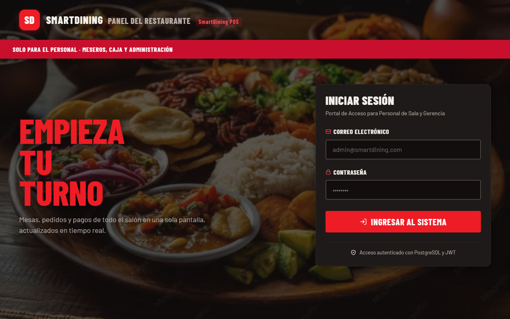

Escribe tu correo y tu contraseña, y toca **Ingresar al Sistema**.

- Si el correo o la contraseña están mal, la pantalla te lo dice.
- Si lo intentas muchas veces seguidas con la contraseña mal, el panel te pide
  esperar un momento antes de volver a intentar. Es una protección.
- Si el administrador desactiva tu usuario, tu sesión se cierra y vuelves a esta
  pantalla.

### 2.2 Si tu usuario es de cocina

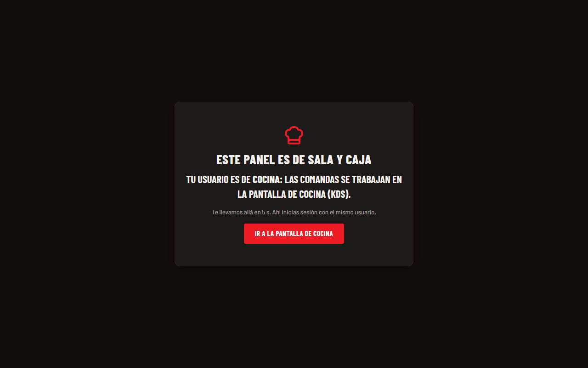

Este panel no es para la cocina. Si entras con un usuario de cocina, sale el
aviso **"ESTE PANEL ES DE SALA Y CAJA"** y a los 5 segundos te lleva a la
pantalla de cocina. Si no quieres esperar, toca **IR A LA PANTALLA DE COCINA**.

Allá vuelves a entrar con el mismo usuario. En el panel no queda ninguna sesión
abierta.

### 2.3 Salir

Al terminar tu turno toca **Cerrar sesión**, arriba a la derecha. Si el equipo
es compartido, no dejes la sesión abierta.

---

## 3. Mesero

### 3.1 Las mesas

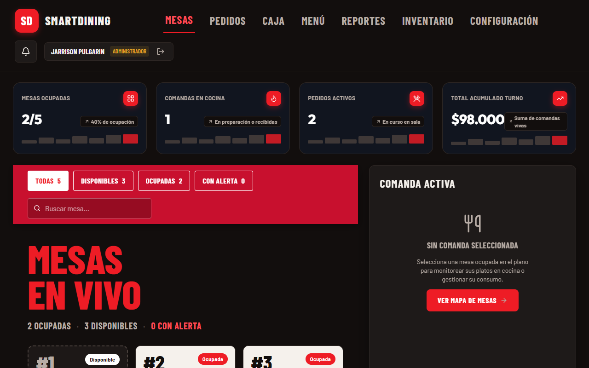

La pantalla **Mesas** muestra todas las mesas con su número, su zona y cuántas
personas caben. Arriba están los filtros **TODAS**, **DISPONIBLES**,
**OCUPADAS** y **CON ALERTA**, cada uno con su cantidad, y un buscador.

- Una mesa **Disponible** dice "Lista para asignar" y tiene el botón **ABRIR / QR**.
- Una mesa **Ocupada** dice "Sesión activa · QR generado" y tiene **VER QR** y
  **LIBERAR**.

### 3.2 Abrir una mesa y entregar el QR

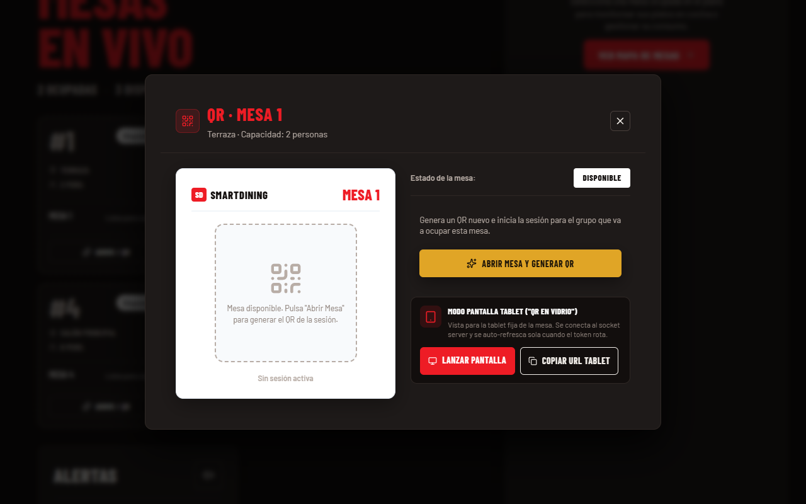

Cuando se sienta un grupo:

1. En la mesa, toca **ABRIR / QR**.
2. Toca **ABRIR MESA Y GENERAR QR**. La mesa pasa a **Ocupada**.

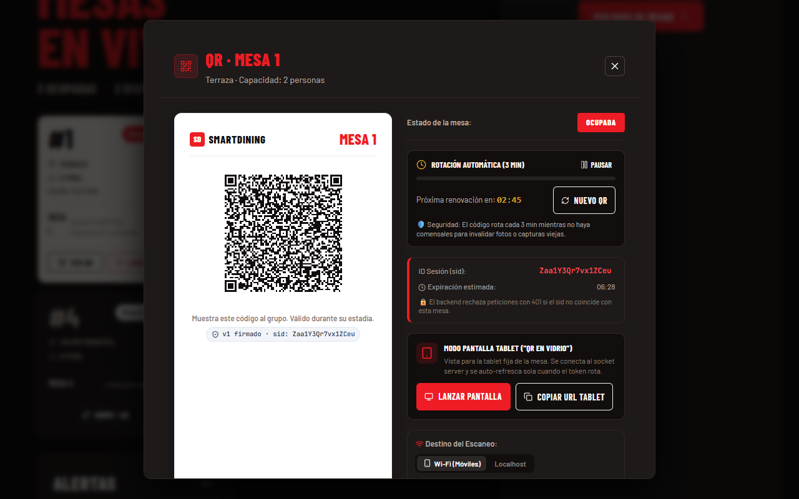

3. Muestra el código al grupo. Cada persona lo escanea con su celular, escribe
   su nombre y pide desde ahí.

Mientras la mesa todavía no tiene comensales, el código **cambia solo cada 3
minutos**, así una foto vieja del QR ya no sirve. Desde esa misma ventana puedes:

- **NUEVO QR**: cambiarlo ya.
- **PAUSAR**: detener el cambio automático.
- **IMPRIMIR** o **GUARDAR SVG**: tenerlo en papel.
- **LIBERAR MESA**: cerrarla (ver 3.4).

Si la mesa tiene una tablet fija, **LANZAR PANTALLA** abre la vista de la tablet,
que muestra el QR y se actualiza sola cuando el código cambia.

### 3.3 Ver una mesa ocupada

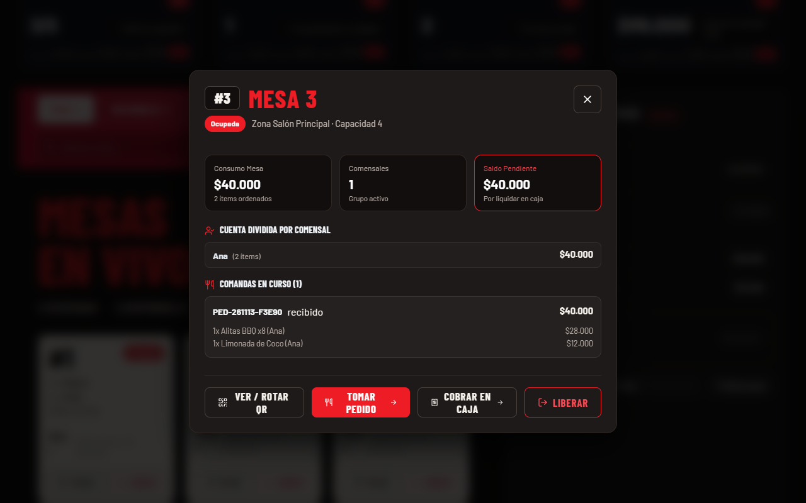

Toca una mesa ocupada para ver su cuenta:

- **Consumo Mesa** y **Saldo Pendiente**.
- **Cuenta dividida por comensal**: lo que pidió cada persona.
- **Comandas en curso**, con su estado y sus platos.

Desde ahí puedes **TOMAR PEDIDO**, **COBRAR EN CAJA** (solo admin y cajero),
**VER / ROTAR QR** o **LIBERAR**.

### 3.4 Liberar una mesa

La mesa se libera **sola** cuando todo está pagado **y** todos sus pedidos
están entregados.

Si se pagó por adelantado y la cocina todavía no ha entregado todo, la mesa
sigue ocupada y el QR sigue sirviendo. Así nadie pierde el seguimiento de su
pedido.

**LIBERAR** es para cerrarla a mano, por ejemplo si el grupo se fue sin pedir.

### 3.5 Cuando una mesa llama

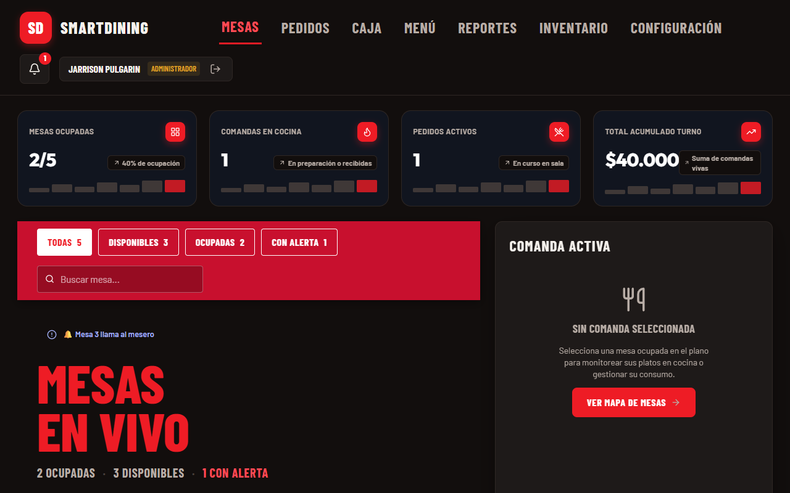

Cuando un cliente toca **Llamar al mesero** en su celular, la mesa aparece en
**CON ALERTA** y el aviso sale en **ALERTAS**, con la hora. Suena un aviso; el
sonido se apaga con **Silenciar sonido**.

Cuando la atiendas, toca **ATENDIDA**.

También llega aquí la petición de la cuenta.

### 3.6 Tomar un pedido por el cliente

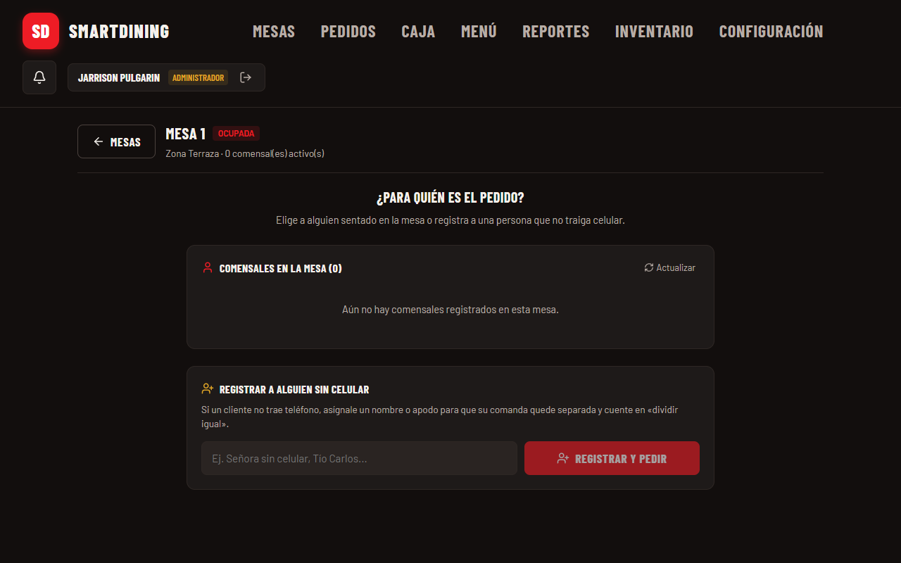

Úsalo cuando un cliente prefiere pedirte a ti, o cuando no trae celular.

1. En la mesa, toca **TOMAR PEDIDO**.
2. Elige **para quién es el pedido**: alguien de **COMENSALES EN LA MESA**, o
   registra a alguien que no trae celular en **REGISTRAR A ALGUIEN SIN
   CELULAR**. Escribe su nombre o un apodo y toca **REGISTRAR Y PEDIR**.

   Así su pedido queda a su nombre y en la Caja se le puede cobrar solo lo
   suyo.
3. Agrega los platos con **Agregar** (o **Personalizar** si el plato se arma) y
   pon notas para la cocina si hace falta.
4. Toca **Enviar comanda a cocina**.

Un plato agotado sale como **AGOTADO** y no se puede agregar.

### 3.7 Los pedidos

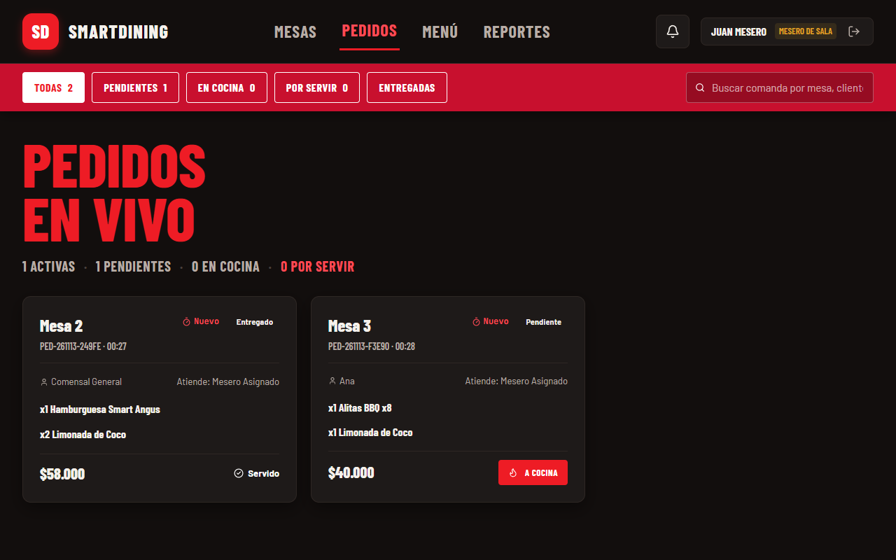

La pantalla **Pedidos** muestra cada comanda con su mesa, su código, su hora,
quién la pidió y sus platos. Los filtros de arriba separan **PENDIENTES**,
**EN COCINA**, **POR SERVIR** y **ENTREGADAS**.

El botón de cada comanda la avanza al siguiente paso: **A COCINA** →
**Marcar Listo** → **Entregar**. Cuando ya se sirvió, dice **Servido**.

Si se cancela un pedido, desaparece de la lista sola, con un aviso.

### 3.8 Cancelar un plato (admin y mesero)

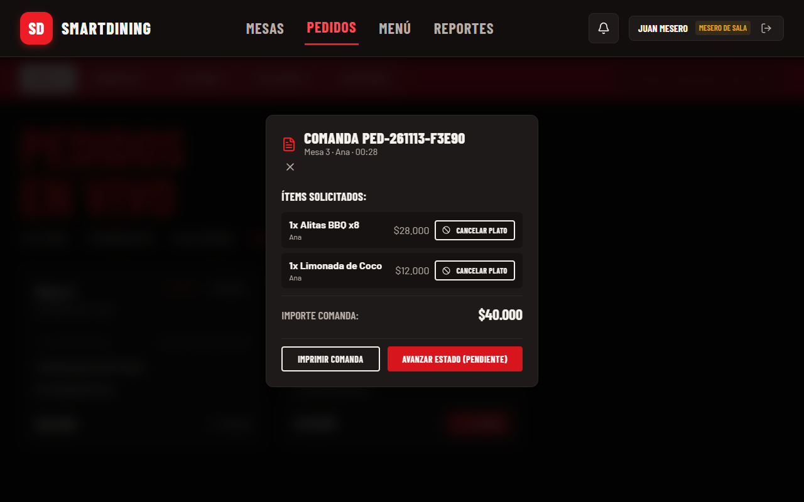

Si el cliente ya no quiere un plato:

1. Toca la comanda para abrir su detalle.
2. En el plato, toca **CANCELAR PLATO**.

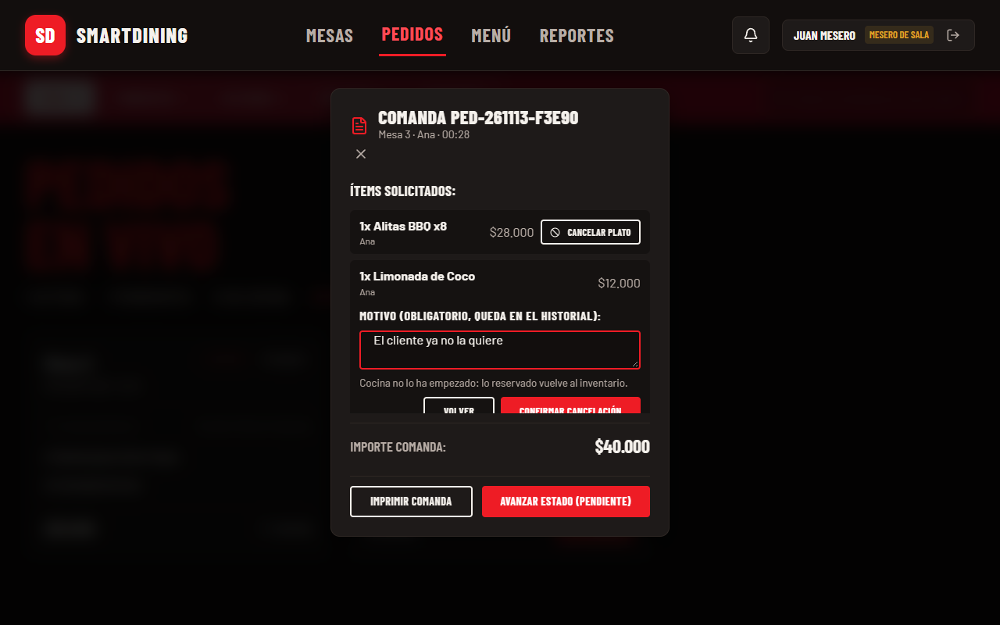

3. Escribe el **motivo**. Es obligatorio y queda en el historial del pedido.
4. Toca **CONFIRMAR CANCELACIÓN**.

La pantalla te dice qué pasa con el inventario antes de confirmar:

- Si la cocina **no lo ha empezado**, lo reservado **vuelve al inventario**.
- Si la cocina **ya lo empezó**, queda como **merma**: no vuelve.

El plato queda tachado y el total se actualiza. Si era el último plato del
pedido, el pedido entero se cancela; la mesa sigue ocupada.

No se puede cancelar:

- un plato ya servido, ni nada de un pedido entregado o pagado;
- el plato de un comensal que **ya pagó** en esta visita. El panel dice «Ese
  comensal ya pagó: reembolsa antes de cancelar su plato»;
- si lo ya pagado queda por encima del total nuevo. En ese caso hay que
  devolver el dinero antes.

El cajero no ve este botón.

### 3.9 Lo que hace el cliente desde su celular

- **Quitar** un plato suyo, mientras la cocina no lo haya empezado.
- **Cancelar pedido**: su pedido completo, solo mientras está recibido, si todo
  es suyo y no tiene pagos.

En los dos casos lo ves en vivo: el plato se tacha o el pedido sale de la lista.

---

## 4. Cajero

### 4.1 La caja

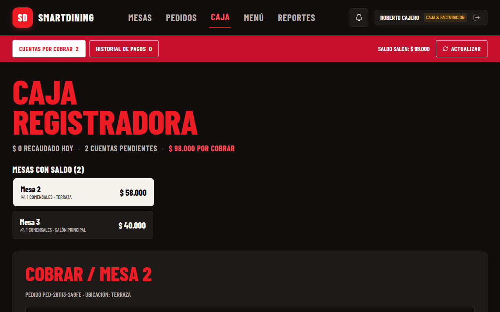

La pantalla **Caja** tiene dos pestañas: **CUENTAS POR COBRAR** y **HISTORIAL
DE PAGOS**. Arriba ves lo **RECAUDADO HOY**, cuántas cuentas faltan y cuánto hay
**POR COBRAR**.

A la izquierda están las mesas con saldo. Al tocar una ves su cuenta:

- el **saldo pendiente de la mesa**;
- lo que pidió cada persona;
- los platos consumidos.

### 4.2 Cobrar

1. Elige qué cobras: **TODA LA MESA** o una persona (división de cuenta). Las
   personas que ya pagaron dicen **PAGADO ✔**.
2. Si el cliente la acepta, marca **INCLUIR PROPINA VOLUNTARIA SUGERIDA (10%)**.
   La propina sale en el recibo, pero no se suma a la cuenta de los pedidos.
3. Elige el método de pago:
   - **EFECTIVO**: escribe lo recibido y el panel calcula el **CAMBIO / VUELTOS**.
   - **T. DÉBITO** o **T. CRÉDITO**: cobra en el datáfono (ver 4.3).
   - **TRANSFERENCIA**: confirma en la app del banco que el dinero llegó antes
     de cobrar.
4. Toca **COBRAR**.

Si se cae la conexión justo al cobrar, vuelve a tocar **COBRAR**: el mismo
cobro no se cobra dos veces.

Si el monto ya no coincide (alguien pagó mientras tanto), el panel te avisa con
el saldo real y recarga las cuentas.

A una persona no se le puede cobrar más que lo suyo: la Caja no deja cobrar de
más. Lo de los demás se cobra a cada uno o con **TODA LA MESA**.

### 4.3 Cobro con tarjeta y voucher

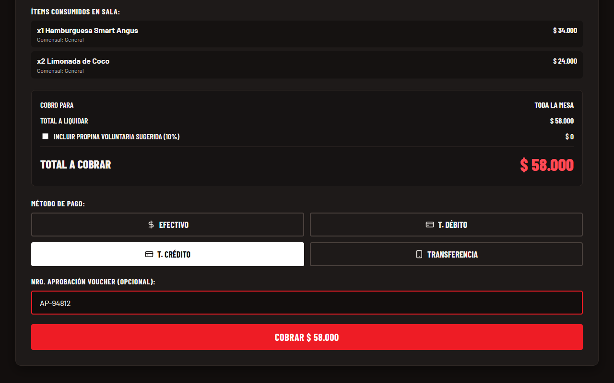

Con tarjeta aparece el campo **NRO. APROBACIÓN VOUCHER (OPCIONAL)**. Copia el
número del voucher del datáfono. Solo admite letras, números y guiones, hasta
40 caracteres, y se escribe en mayúsculas solo.

Es opcional: si el datáfono no lo imprimió, cobra igual.

### 4.4 El recibo

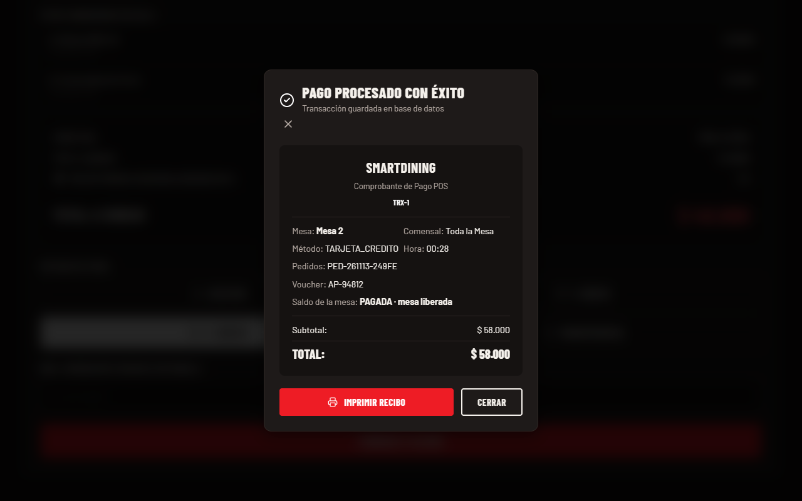

Después de cobrar sale el recibo, con el número de transacción, la mesa, el
método, los pedidos, el voucher (si hubo) y el **saldo de la mesa**. Si la mesa
quedó pagada y servida, dice **PAGADA · mesa liberada**.

Toca **IMPRIMIR RECIBO** para imprimirlo.

### 4.5 El historial del día

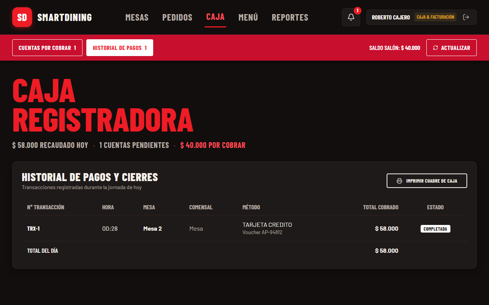

**HISTORIAL DE PAGOS** muestra lo cobrado hoy, del más reciente al más viejo:
número, hora, mesa, quién, método (con su voucher) y monto. Un cobro que se
repartió entre varios pedidos sale en una sola fila. Abajo está el **TOTAL DEL
DÍA**, que coincide con lo recaudado hoy.

**IMPRIMIR CUADRE DE CAJA** lo imprime para el cierre.

---

## 5. Administrador

### 5.1 El menú

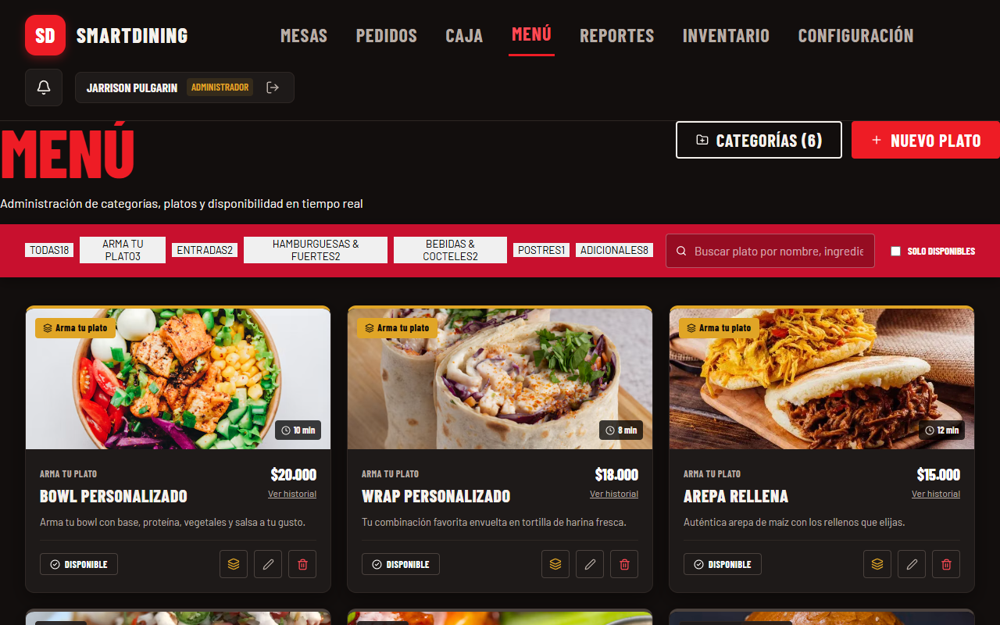

En **Menú** están todos los platos, también los agotados, por categoría. Arriba
están las categorías (**CATEGORÍAS**), el botón **NUEVO PLATO**, los filtros
por categoría, **SOLO DISPONIBLES** y el buscador.

En cada plato puedes:

- **DISPONIBLE**: apagarlo o encenderlo a mano. Al apagarlo, los clientes dejan
  de verlo en el menú al instante.
- **Ver historial**: sus cambios de precio (ver 5.4).
- **Editar plato** o **Eliminar plato**.
- **Configurar pasos**: en los platos que se arman (ver 5.3).

Un plato que sale **AGOTADO · SIN STOCK** se quedó sin algún insumo del
inventario. Vuelve solo cuando registras una entrada de ese insumo (ver 5.6).

### 5.2 Crear o editar un plato

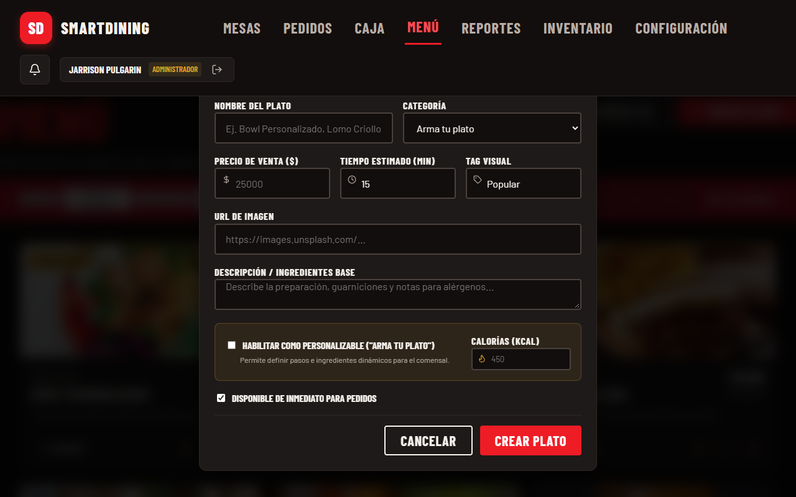

Llena nombre, categoría, precio, tiempo estimado, descripción y, si quieres,
calorías y la **URL DE IMAGEN**.

- La URL de imagen debe empezar por **https://**, o ser la ruta
  `/imagenes/<código>.webp` de una imagen ya subida. Una dirección **http://**
  no se acepta: el panel dice «La imagen debe ser una dirección https:// o una
  imagen subida».
- Si no pones imagen, el plato queda **sin foto**. En la tarjeta se ve una foto
  genérica, pero no se guarda como suya.
- **HABILITAR COMO PERSONALIZABLE ("ARMA TU PLATO")** hace que el cliente arme
  el plato por pasos.
- **DISPONIBLE DE INMEDIATO PARA PEDIDOS** lo publica apenas lo crees.

Un cambio de precio no toca los pedidos ya hechos: cada uno conserva el precio
que tenía.

### 5.3 Platos que se arman ("Arma tu plato")

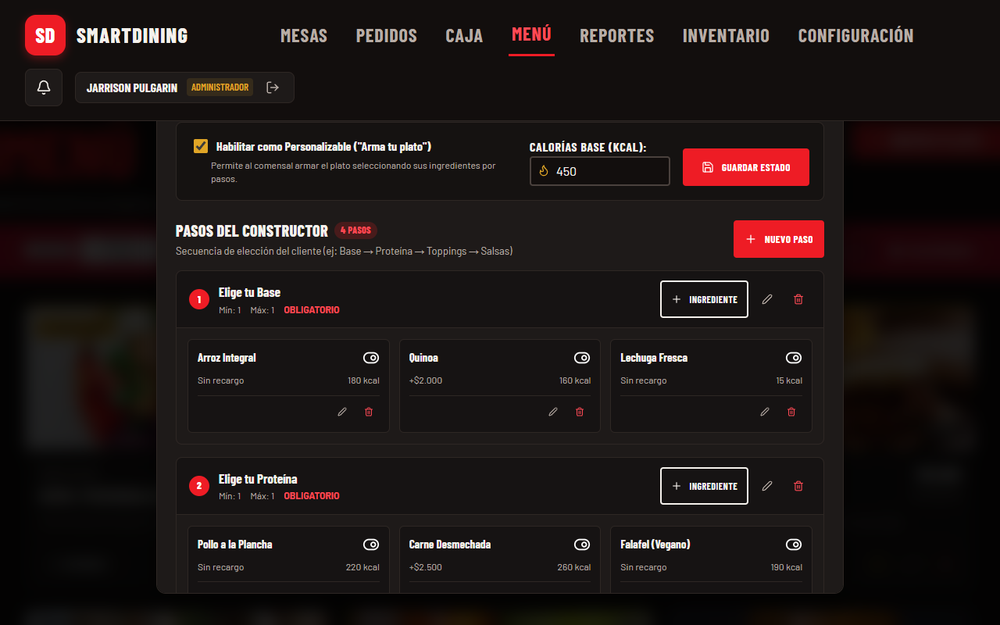

El **Constructor de plato** define los pasos que sigue el cliente, por ejemplo
Base → Proteína → Toppings → Salsas. Cada paso tiene:

- cuántas opciones se eligen como mínimo (**Mín**) y como máximo (**Máx**);
- si es **OBLIGATORIO** u **OPCIONAL**;
- sus ingredientes, cada uno con su recargo (o **Sin recargo**) y sus calorías.

Agrega pasos con **NUEVO PASO**. Guarda con **GUARDAR ESTADO**.

### 5.4 Historial de precios

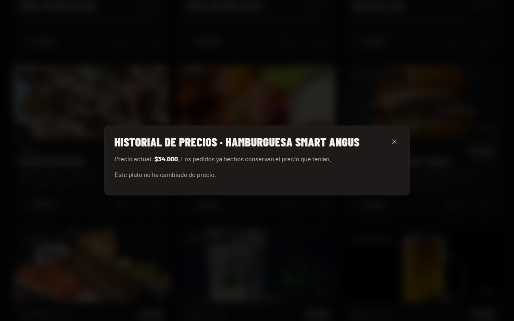

**Ver historial** muestra cada cambio de precio del plato y quién lo hizo. Si
nunca cambió, lo dice.

### 5.5 Inventario: insumos

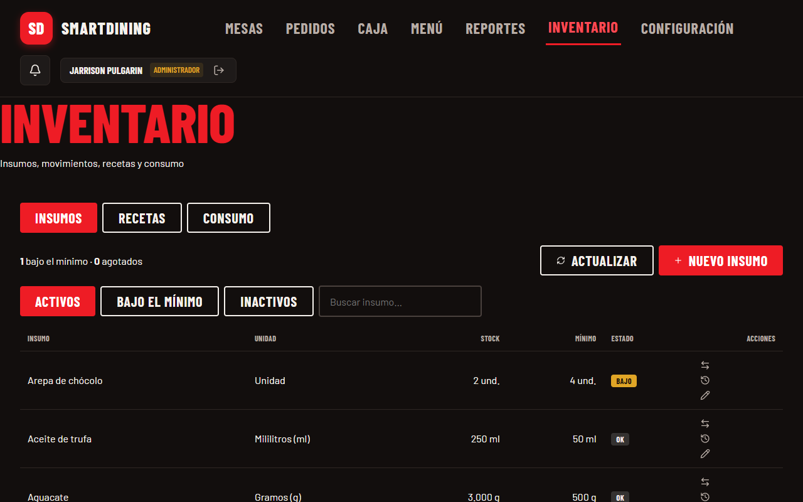

**Inventario** tiene tres pestañas: **INSUMOS**, **RECETAS** y **CONSUMO**.

En **INSUMOS** está lo que hay en bodega, con su stock y su estado. Arriba dice
cuántos insumos están **bajo el mínimo** y cuántos **agotados**. Los filtros son
**ACTIVOS**, **BAJO EL MÍNIMO** e **INACTIVOS**.

Cuando un insumo llega al mínimo o se agota, sale un **aviso en vivo** arriba de
la lista.

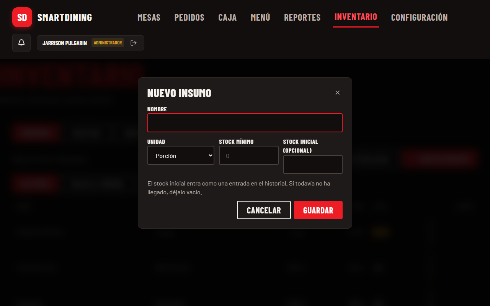

**NUEVO INSUMO**: nombre, unidad (porción, unidad, gramos o mililitros), stock
mínimo y, si ya llegó, el **stock inicial**. El stock inicial queda en el
historial como una entrada.

### 5.6 Registrar un movimiento

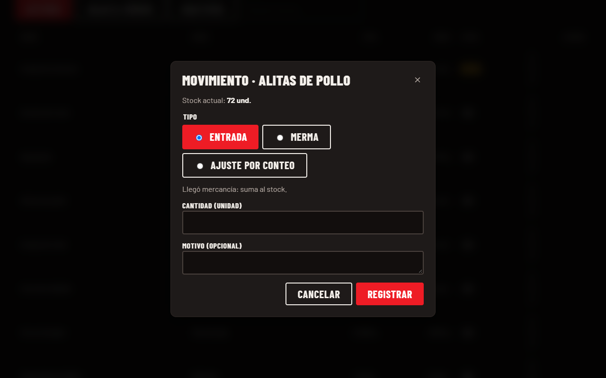

El stock no se edita a mano: se mueve con movimientos. En el insumo, toca
**Movimiento** y elige el tipo:

- **ENTRADA**: llegó mercancía. Suma al stock y devuelve a la carta los platos
  que estaban sin stock.
- **MERMA**: se dañó o se botó. Resta.
- **AJUSTE POR CONTEO**: contaste y el número real es otro. Puede sumar o
  restar.

Escribe la cantidad y, si quieres, un motivo. Toca **REGISTRAR**.

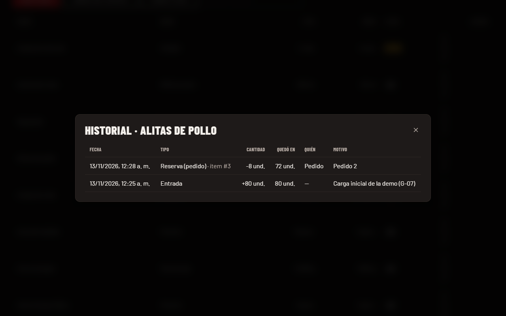

**Historial** muestra cada movimiento: fecha, tipo, cantidad, en cuánto quedó,
quién lo hizo y el motivo. Los pedidos también aparecen: la **reserva** de cada
plato, y su devolución o su merma si se canceló.

### 5.7 Recetas

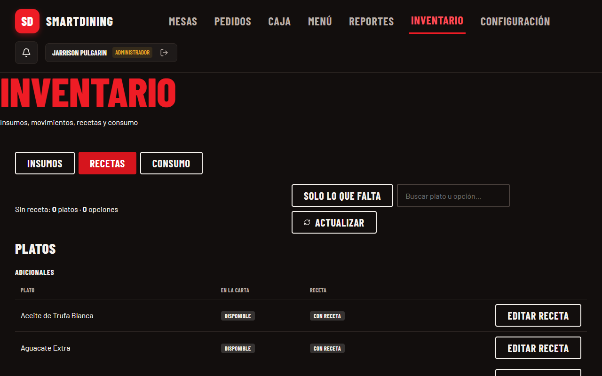

La receta dice cuánto gasta **una unidad** de un plato. Con ella el sistema
descuenta el inventario en cada pedido y sabe cuándo un plato queda sin stock.

**RECETAS** lista los platos por categoría, con su estado: **CON RECETA** o sin
ella. Los platos que se arman consumen por sus opciones, así que la receta va en
cada opción, en **OPCIONES DEL CONSTRUCTOR**. **SOLO LO QUE FALTA** deja ver
solo lo que no tiene receta.

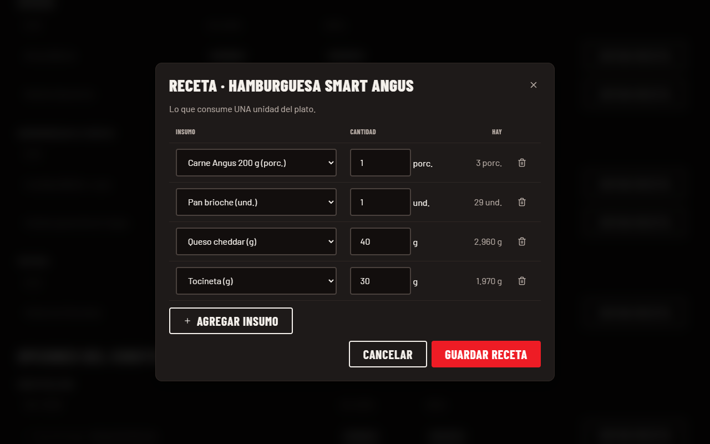

En **EDITAR RECETA** (o **AGREGAR RECETA**) eliges cada insumo y su cantidad.
**AGREGAR INSUMO** suma una fila y la papelera la quita. La columna **HAY**
muestra cuánto queda de ese insumo. Guarda con **GUARDAR RECETA**.

### 5.8 Consumo

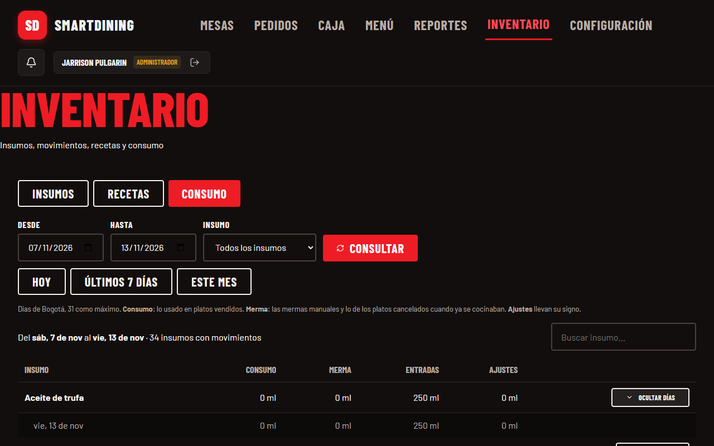

**CONSUMO** dice cuánto se gastó de cada insumo en un rango de días:

1. Elige **DESDE** y **HASTA**, o un atajo: **HOY**, **ÚLTIMOS 7 DÍAS** o
   **ESTE MES**. El rango puede tener hasta 31 días y no puede ser futuro.
2. Si quieres, elige un solo **INSUMO**.
3. Toca **CONSULTAR**.

Por cada insumo, en su unidad:

| Columna | Qué es |
|---|---|
| **CONSUMO** | Lo usado en platos vendidos. Un plato quitado antes de que la cocina lo empezara no cuenta. |
| **MERMA** | Las mermas registradas a mano, más lo de los platos cancelados cuando ya se cocinaban. |
| **ENTRADAS** | Lo que llegó. |
| **AJUSTES** | Los ajustes por conteo, con su signo (+ o −). |

**VER DÍAS** abre el detalle de cada día. Los días son los de Bogotá.

### 5.9 Configuración

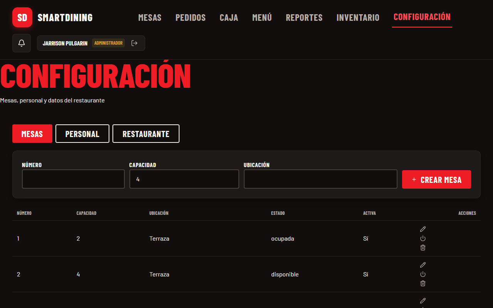

**MESAS**: crea una mesa con su número, capacidad y ubicación (**CREAR MESA**),
edítala o desactívala. Una mesa ocupada no se puede desactivar.

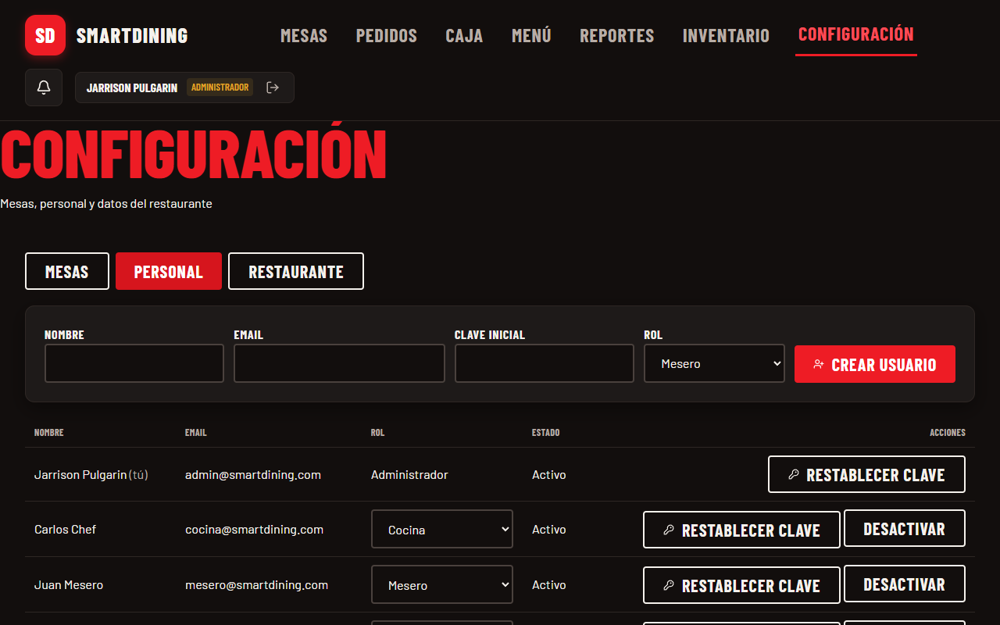

**PERSONAL**: crea usuarios con nombre, email, **CLAVE INICIAL** y rol
(Administrador, Mesero, Cajero o Cocina). En cada persona puedes cambiar el rol,
**RESTABLECER CLAVE** o **DESACTIVAR**. Sobre ti mismo no puedes hacer esas
acciones: sale marcado **(tú)**.

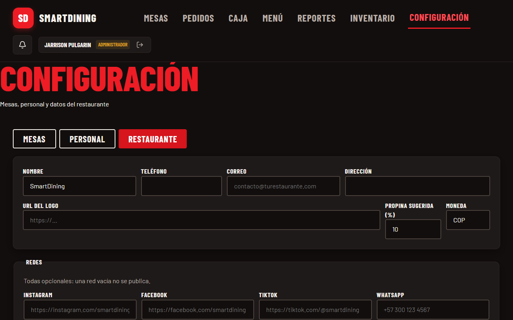

**RESTAURANTE**: nombre, teléfono, correo, dirección, logo, propina sugerida,
moneda, redes (Instagram, Facebook, TikTok, WhatsApp) y el horario de cada día.
Guarda con **GUARDAR CAMBIOS**.

### 5.10 Reportes

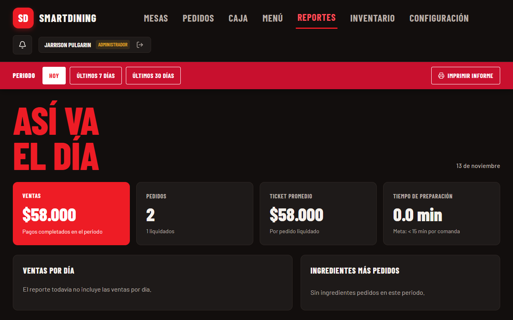

**Reportes** muestra cómo va el negocio: **HOY**, **ÚLTIMOS 7 DÍAS** o
**ÚLTIMOS 30 DÍAS**.

- **Ventas**, **pedidos**, **ticket promedio** y **tiempo de preparación**.
- **Platos** e **ingredientes más pedidos**.
- **Ventas por día**: una barra por cada día del periodo, en hora de Colombia;
  los días sin ventas quedan en cero. Al pasar el puntero sobre una barra se ven
  el total y los pedidos de ese día.
- **Métodos de pago** (cada método con su color), **horas pico** y la
  **eficiencia de la cocina**.

Las cuentas cuadran entre sí: las **ventas** son la suma de los **métodos de
pago**. En **HOY**, debajo de los métodos, el panel dice si esa suma **cuadra
con «Recaudado hoy»** de la Caja. Si no cuadra, muestra la diferencia; puede
ser un cobro de hace menos de un minuto, porque el reporte se guarda 60
segundos.

**IMPRIMIR INFORME** lo imprime.

Si el servidor no responde, el reporte lo dice: nunca muestra cifras
inventadas.

---

## 6. Problemas comunes

| Qué pasa | Qué hacer |
|---|---|
| Un aviso dice **"Sin conexión"** | El panel no llega al servidor y lo que hiciste **no se guardó**. Revisa el internet e inténtalo otra vez. |
| Un plato no se puede pedir | Está apagado a mano o **AGOTADO · SIN STOCK**. Revisa su receta o registra la entrada del insumo. |
| El cliente dice que el QR no sirve | Toca **NUEVO QR** y muéstrale el nuevo: el de la foto ya venció. |
| La caja dice que el monto supera lo que se debe | Alguien pagó mientras tanto. Toca **ACTUALIZAR** y cobra el saldo real. |
| No se deja cancelar un plato | Ya se sirvió, el pedido está entregado o pagado, o lo pagado supera el total nuevo. |
| Entré con el usuario de cocina | Es normal: el panel te lleva a la pantalla de cocina. |
