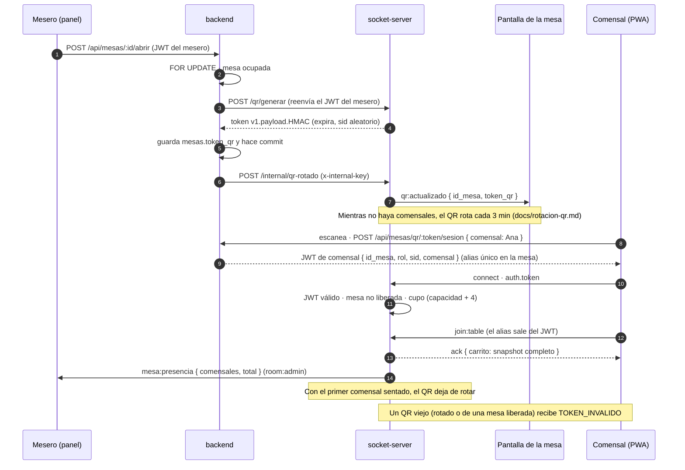
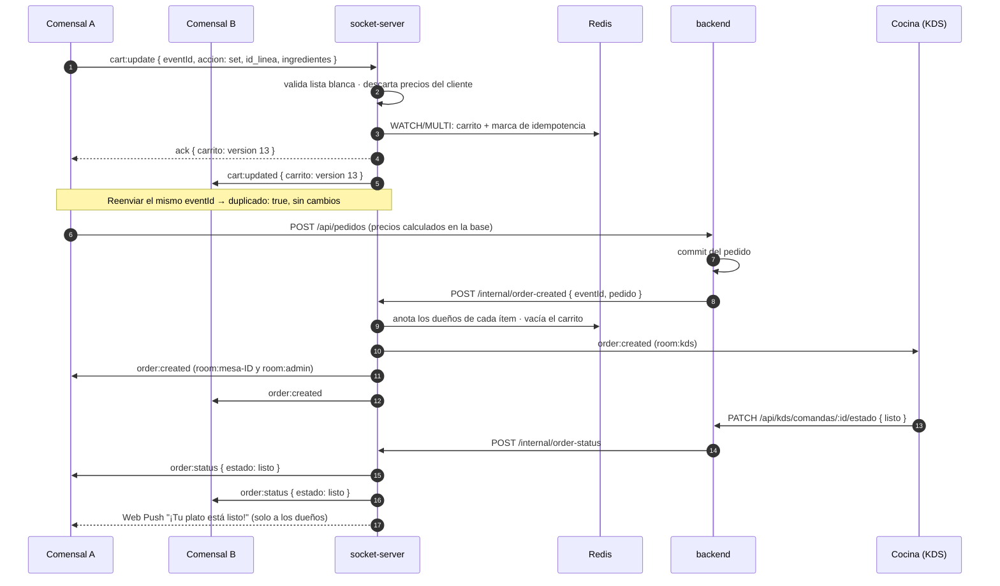
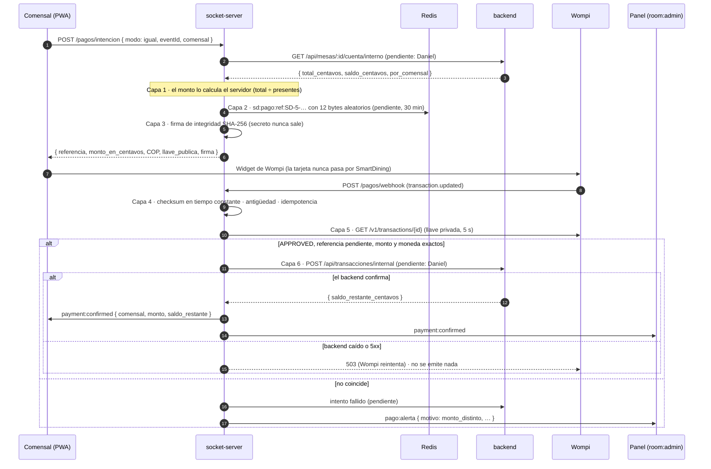
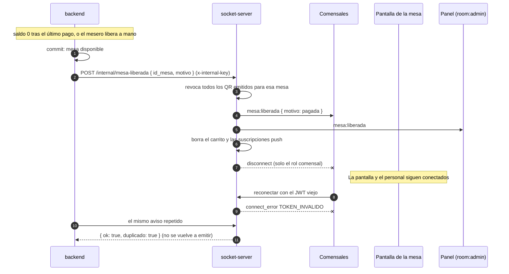

# ⚡ Módulo Socket Server (WebSockets & Tiempo Real)

**Responsable:** Roberto Buelvas (Integrante 4)

## Descripción
Servidor de comunicación bidireccional en tiempo real con **Socket.io** para sincronizar las mesas, comandas de cocina y notificaciones de pedidos.

## Levantar en local

1. `npm install`
2. Copia `.env.example` a `.env` y completa:
   - `JWT_SECRET`: el **mismo** que usa `backend/`, o los tokens que emite el backend
     (o `npm run token:comensal`) no van a validar aquí.
   - `INTERNAL_API_KEY`: la **misma** que usa `backend/` para llamar a `/internal/*`.
   - `CORS_ORIGINS` ya trae por defecto los puertos de Vite 5173 a 5175
     (`frontend-cliente`, `frontend-restaurante`, `frontend-kds`); ajústalo si usas otro.
3. `npm run dev` → escucha en `http://localhost:4001` (el backend REST usa el `4000`).
4. Token de prueba sin depender del backend: `npm run token:comensal -- --mesa 5 --comensal Ana`
   (opcional `--sid <texto>` y `--horas <n>`, por defecto 3). Se niega a correr si falta
   `JWT_SECRET` o si `NODE_ENV=production`.

### Para frontend-cliente

```js
import { io } from 'socket.io-client';

const socket = io('http://localhost:4001', { auth: { token } }); // token de arriba
socket.emit('join:table', {}, (ack) => { /* ack.carrito trae el snapshot inicial */ });

socket.emit('cart:update', {
  eventId: crypto.randomUUID(),
  accion: 'set',
  id_linea: crypto.randomUUID(), // uno por línea añadida; reusarlo edita esa línea
  id_plato: 3,                   // sin `comensal`: el servidor usa el alias del JWT
  cantidad: 2,
  notas: 'sin cebolla',
}, (ack) => { /* ack.carrito trae el snapshot resultante */ });
```

### Notificaciones push y iPhone

El aviso principal de "tu plato está listo" es el evento de socket `order:status` dentro de la
PWA. El Web Push es un extra para cuando el comensal cerró la app:

- **Android (Chrome, Edge, Firefox) y escritorio:** funciona desde el navegador.
- **iPhone/iPad:** solo con **iOS 16.4 o posterior** y con la PWA **instalada** (Compartir →
  "Agregar a pantalla de inicio"), abierta desde ese ícono y después de que el comensal
  acepte el permiso. En Safari sin instalar, `PushManager` no existe y el push no llega.
- Por eso la PWA no debe depender del push: tiene que mostrar el estado del pedido en vivo
  con el socket, y ofrecer las notificaciones solo cuando `'PushManager' in window`.

Service worker de referencia: [examples/sw-push.js](examples/sw-push.js).

### Persistencia con Redis

Con `REDIS_URL` el estado vive en Redis y sobrevive a reinicios (sin ella, solo en desarrollo,
vive en memoria; con `NODE_ENV=production` el servidor no arranca sin Redis):

| Llave | Tipo | Contenido | TTL |
|---|---|---|---|
| `sd:carrito:{mesa}` | string (JSON) | `{ version, items }`, actualizado con WATCH/MULTI | 24 h |
| `sd:idem:{ámbito}:{eventId}` | string | eventos ya procesados (`SET NX`) | 10 min (pagos: 7 días) |
| `sd:qr:revocado:{mesa}` | string | ms de la última liberación de la mesa | 25 h |
| `sd:push:{mesa}` | hash | endpoint → suscripción Web Push | 24 h |

El ámbito de `sd:idem` empieza por el rol cuando el evento viene de un socket (por ejemplo
`sd:idem:comensal:cart:5:<eventId>`) y por el tipo de evento cuando viene del backend
(`sd:idem:order:status:<eventId>`), para que el mismo UUID en otra mesa no sea un duplicado.

Si Redis se cae: `/health` responde `503 degradado`, los eventos que cambian estado
responden `ERROR_INTERNO` (el cliente reintenta con el mismo `eventId`) y las conexiones de
comensal se rechazan con `ERROR_INTERNO`. Nunca se pasa a memoria en silencio.

**Prueba manual (persistencia tras reinicio):**

1. `docker compose up -d redis` en la raíz y `REDIS_URL=redis://localhost:6379` en `.env`.
2. `npm run dev` y `npm run token:comensal -- --mesa 5 --comensal Ana` (copia el token).
3. Conecta un cliente, haz `join:table` y dos `cart:update` (ver el ejemplo de abajo).
4. Detén el servidor (Ctrl+C) y vuelve a correr `npm run dev`.
5. Conecta otro cliente con el mismo token y haz `join:table`: el `carrito` del ack debe ser
   **idéntico** (misma `version` y mismos `items`) al último snapshot antes del reinicio.
6. Reenvía uno de los `cart:update` anteriores con su mismo `eventId`: responde
   `duplicado: true` y la `version` no cambia.

`id_linea`, roles, `clear` (solo personal) y el resto de eventos están documentados en
detalle en [EVENTS.md](EVENTS.md).

## Diagramas de secuencia

Los cuatro momentos de una visita, tal como los implementa el servidor. Los
contratos exactos están en [EVENTS.md](EVENTS.md); lo que todavía depende del
backend va marcado como *pendiente*.

### 1. Apertura de la mesa con QR



### 2. Pedido en vivo



### 3. Pago dividido (las 6 capas)



### 4. Liberación de la mesa



## Tareas Iniciales
1. **Definición de eventos:** Documentar los eventos de WebSocket (nombres de eventos, payloads y salas/rooms por mesa).
   - `join:table`: Unirse a la sala de una mesa mediante token.
   - `cart:update`: Sincronizar el carrito de compras colaborativo entre comensales de la misma mesa.
   - `order:created`: Notificar nueva comanda a la cocina (KDS).
   - `order:status`: Notificar al cliente y al restaurante el cambio de estado del pedido.
2. **Generación de Token QR:** Definir formato de token y validación para el acceso a las mesas.
3. **Módulo de Notificaciones Push & Pagos:** Integración de suscripciones Web Push y lógica de webhook/confirmación de pagos.
