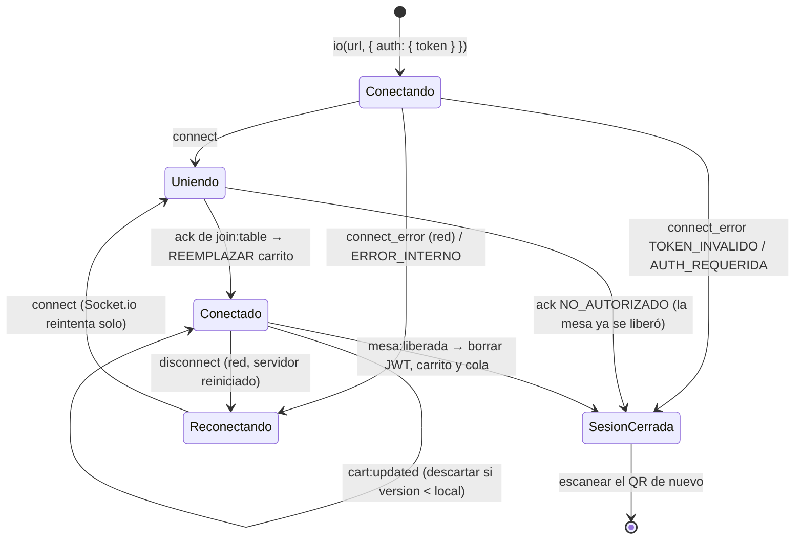
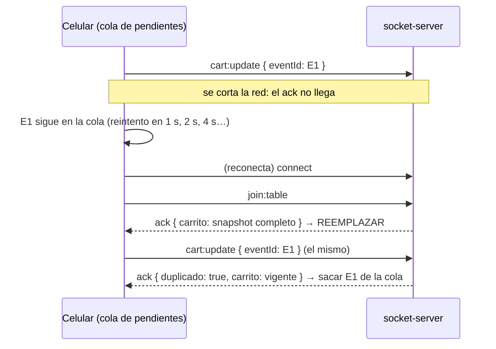

# Guía de integración para clientes del socket-server

Para quien construye la PWA del comensal (`frontend-cliente`) o el panel
(`frontend-restaurante`). El contrato completo de eventos está en [EVENTS.md](../EVENTS.md);
aquí se explica **cómo usarlo bien**: reconexión, reintentos e idempotencia.

Hay una implementación de referencia lista para copiar:

- [`examples/clienteMesa.js`](../examples/clienteMesa.js): la lógica, sin React (probada en
  `tests/cliente-referencia.test.js` contra el servidor real).
- [`examples/useMesaSocket.js`](../examples/useMesaSocket.js): el hook de React que la envuelve.

## 1. Conexión

```js
import { io } from 'socket.io-client';

const socket = io(import.meta.env.VITE_SOCKET_URL, {
  auth: { token },              // JWT de POST /api/mesas/qr/:token/sesion
  transports: ['websocket', 'polling'],
});
```

### El alias va dentro del JWT

El comensal elige su nombre **una vez**, al abrir la sesión:

```js
const r = await fetch(`${API_URL}/mesas/qr/${encodeURIComponent(tokenQr)}/sesion`, {
  method: 'POST',
  headers: { 'Content-Type': 'application/json' },
  body: JSON.stringify({ comensal: 'Ana' }),
});
// 201 { token, comensal: 'Ana', ... }  ·  409 alias_en_uso → pedir otro nombre
```

El backend lo valida (2–40 caracteres, único en la mesa) y lo **firma** en el JWT. Desde ahí:

- **No mandes `comensal`** en `join:table`, `cart:update`, `push:subscribe`,
  `/push/suscripcion` ni `/pagos/intencion`: el servidor usa el del JWT. Si mandas uno
  distinto, responde `NO_AUTORIZADO` (403 por HTTP). Así nadie edita, quita o paga como otro.
- Un comensal solo puede editar o quitar **sus** líneas del carrito; las de otro responden
  `NO_AUTORIZADO`.
- Para mostrar "eres Ana", usa `aliasDelToken(token)` de `examples/clienteMesa.js` (el hook
  lo expone como `comensal`). Solo decodifica: no sirve para decidir nada.
- Un JWT **antiguo sin alias** ya no conecta: `connect_error` con `TOKEN_INVALIDO` (y 401
  `TOKEN_INVALIDO` por HTTP). Hay que volver a escanear el QR.

- El JWT va en `auth.token`, **nunca** en la URL (quedaría en logs y en el historial).
- `VITE_SOCKET_URL` es pública (no es un secreto). Ningún secreto va con prefijo `VITE_`.
- Si el handshake falla, llega `connect_error` con `err.message`:
  - `AUTH_REQUERIDA` / `TOKEN_INVALIDO`: el JWT falta, venció, no trae alias o la mesa ya se liberó. Socket.io
    **no** reintenta solo en este caso. Hay que pedir sesión nueva (volver a escanear el QR).
  - `ERROR_INTERNO`: el servidor no pudo comprobar la sesión (p. ej. Redis caído). Reintenta
    más tarde.

## 2. `join:table` al conectar y en CADA reconexión

El evento `connect` se dispara en la primera conexión **y** en cada reconexión. En los dos casos:

```js
socket.on('connect', () => {
  socket.emit('join:table', {}, (ack) => {        // el alias sale del JWT
    if (ack.ok) reemplazarCarrito(ack.carrito);   // REEMPLAZAR, no mezclar
  });
});
```

- Tras una reconexión el socket es **nuevo** y no está en ninguna sala: sin `join:table` no
  recibes nada de la mesa y `cart:update` responde `SIN_SALA`.
- El ack trae el **snapshot completo** del carrito. **Reemplaza** el carrito local con él:
  mientras estabas desconectado pudieron cambiar cosas que no viste, y mezclar duplicaría líneas.
- Aquí **sí** se acepta cualquier `version`, aunque sea menor: si el servidor se reinició sin
  Redis, la versión vuelve a empezar y el snapshot del join es la verdad.

## 3. Snapshots desordenados: descartar versiones viejas

`cart:updated` (de los demás) y el `carrito` del ack (tuyo) traen `{ version, items }`:

```js
function aplicarSnapshot(nuevo) {
  if (nuevo.version < carrito.version) return;  // llegó tarde: ya tengo uno más nuevo
  carrito = nuevo;                              // reemplazo completo
}
```

El emisor de un `cart:update` **no** recibe `cart:updated`: usa el `carrito` de su ack.

## 4. Cola de pendientes con reintento por `eventId`

Todo evento que cambia estado lleva un `eventId` (UUID v4) **generado una sola vez por acción
del usuario**. Si el ack no llega, se reenvía **el mismo** evento con **el mismo** `eventId`: el
servidor lo reconoce y responde `duplicado: true` sin aplicarlo dos veces.

| Situación | Qué hacer |
|---|---|
| ack `ok: true` (o `duplicado: true`) | Sacar de la cola. Aplicar `ack.carrito` si viene |
| ack `PAYLOAD_INVALIDO`, `NO_AUTORIZADO`, `RATE_LIMIT`, `SIN_SALA`* | Sacar de la cola y avisar al usuario: reintentar no lo arregla |
| ack `ERROR_INTERNO` o sin ack en 5 s | Dejar en la cola y reintentar con espera de **1 s, 2 s, 4 s, 4 s** (5 intentos en total). Después, avisar al usuario |
| Desconectado | Dejar en la cola. Al reconectar: `join:table` primero y **después** reenviar la cola |

\* `SIN_SALA` solo debería pasar si se envió antes de terminar el `join:table`; la cola lo evita
porque no envía hasta tener sala.

```js
// eventId: crypto.randomUUID() solo existe en contextos seguros (https o localhost).
// En la red local por http (celular → 192.168.x.x) no está: usa getRandomValues.
function uuidV4() {
  if (globalThis.crypto?.randomUUID) return crypto.randomUUID();
  const b = crypto.getRandomValues(new Uint8Array(16));
  b[6] = (b[6] & 0x0f) | 0x40; b[8] = (b[8] & 0x3f) | 0x80;
  const h = [...b].map((x) => x.toString(16).padStart(2, '0')).join('');
  return `${h.slice(0, 8)}-${h.slice(8, 12)}-${h.slice(12, 16)}-${h.slice(16, 20)}-${h.slice(20)}`;
}
```

Guarda la cola en memoria. Si la persistes (p. ej. `sessionStorage`), conserva el `eventId`
original de cada evento.

## 5. `TOKEN_INVALIDO` y `mesa:liberada`

- **`connect_error` con `TOKEN_INVALIDO`**: la sesión ya no vale. Borra el JWT, el carrito y la
  cola, y muestra "Escanea el QR de la mesa".
- **`mesa:liberada`** `{ id_mesa, motivo, emitidoEn }`: la mesa se pagó (`motivo: "pagada"`) o
  el mesero la liberó (`"liberada"`). Justo después el servidor **desconecta** al comensal.
  1. Muestra "¡Gracias por tu visita!" (o "La mesa se cerró").
  2. Borra el JWT, el carrito y la cola de pendientes. **No** reenvíes nada.
  3. **No** reconectes: Socket.io no lo hace solo tras una desconexión del servidor, y si
     alguien lo intenta, el JWT viejo ya no entra (`TOKEN_INVALIDO`).

## 6. Diagrama de reconexión





## 7. Lista de comprobación

- [ ] El JWT va en `auth.token` y nunca en la URL ni en logs.
- [ ] `join:table` en cada `connect` y **reemplazo** del carrito con el snapshot del ack.
- [ ] `eventId` generado **una vez** por acción y reutilizado en cada reintento.
- [ ] Reintentos 1 s, 2 s, 4 s, 4 s y luego aviso. Sin reintentos para errores de validación.
- [ ] `cart:updated` con `version` menor que la local se descarta.
- [ ] `TOKEN_INVALIDO` y `mesa:liberada` borran la sesión local y no reconectan.
- [ ] Ninguna llamada a `/internal/*` desde el navegador.
