# Rotación automática del QR de mesa

**Regla:** mientras una mesa está abierta (ocupada) y **no hay ningún comensal conectado**, su
QR cambia cada 3 minutos (`ROTACION_QR_MINUTOS`). Con el **primer comensal** en la sala, el QR
queda **fijo** hasta que la mesa se libere.

**Por qué:** entre que el mesero abre la mesa y se sienta el grupo, el QR está a la vista en
la tablet. Quien lo fotografíe podría entrar a esa mesa más tarde. Si el QR rota, esa foto
deja de servir a los 3 minutos. Cuando el grupo ya está sentado, el QR no rota más, para que
los que lleguen después escaneen el mismo.

## Opciones evaluadas

| | A) Temporizador en el socket-server | B) Temporizador en la tablet |
|---|---|---|
| Quién decide si la mesa está vacía | El servidor, con los sockets reales de la sala | La tablet, con `mesa:presencia`… que hoy solo recibe `room:admin` (la pantalla no) |
| Credencial que usa | `INTERNAL_API_KEY`, de servidor a servidor, que ya existe y Nginx bloquea desde fuera | El **JWT de un mesero guardado en la tablet**, a la vista de los comensales (el mismo riesgo que H2) |
| Si nadie tiene el panel abierto | Funciona | Funciona solo si la tablet está despierta y con sesión de personal |
| Confiabilidad del reloj | Temporizador del servidor | El navegador duerme las pestañas inactivas y retrasa los temporizadores |
| Trabajo de otros integrantes | **Un** endpoint pequeño en el backend (Daniel) | Cambios en `frontend-restaurante` (Jarrinson) y un rol nuevo con permisos de rotación |
| Superficie de ataque nueva | Una ruta interna más, solo servidor a servidor | Un token con permisos de personal en un dispositivo público |

**Decisión: A.** Expone menos superficie (ningún secreto ni token de personal sale de los
servidores) y depende de un único endpoint pequeño del backend.

Contras de A que se aceptan:

- El conjunto de mesas que se están rotando vive en memoria del proceso: tras un reinicio, la
  rotación de una mesa vuelve a empezar cuando el personal la abre o rota a mano.
- Con varias instancias del socket-server, cada una rotaría las mesas que abrió. Hoy hay una
  sola instancia; si se escala, conviene un candado en Redis por mesa.

## Flujo

```mermaid
sequenceDiagram
  participant T as Temporizador (socket-server)
  participant S as socket-server
  participant B as backend
  participant P as Pantalla de la mesa
  Note over S: /qr/generar (mesero abre la mesa) → empieza la cuenta
  T->>S: pasaron 3 min
  S->>S: presencia de la sala = 0 comensales?
  alt hay comensales
    S->>S: deja de rotar (QR fijo)
  else mesa vacía
    S->>S: firma un QR nuevo (v1, HMAC)
    S->>B: POST /api/mesas/:id/token-qr/interno { token_qr, token_anterior } (x-internal-key)
    alt 200
      B-->>S: guardado (FOR UPDATE, mesa ocupada, token_anterior coincide)
      S->>P: qr:actualizado { id_mesa, token_qr }
    else 409 / 404
      B-->>S: la mesa ya no está ocupada o alguien rotó a mano
      S->>S: deja de rotar esa mesa
    else error o sin respuesta (1500 ms)
      S->>S: conserva el QR anterior (sigue válido) y reintenta en 3 min
    end
  end
```



## BLOQUEADO para Daniel: contrato del endpoint del backend

```
POST /api/mesas/:id/token-qr/interno
x-internal-key: <INTERNAL_API_KEY>
Content-Type: application/json

{ "token_qr": "v1.<payload>.<firma>", "token_anterior": "v1...." }
```

Comportamiento esperado:

1. Exigir `x-internal-key` con comparación en tiempo constante; sin ella, `401`.
2. `BEGIN`; `SELECT ... FROM mesas WHERE id_mesa = $1 FOR UPDATE`.
3. `404` si la mesa no existe. `409` si `estado <> 'ocupada'`.
4. **Compare-and-swap:** `409` si `token_anterior` no es `NULL` y no coincide con
   `mesas.token_qr` (alguien rotó o liberó a mano mientras tanto).
5. `UPDATE mesas SET token_qr = $1`, `COMMIT`, y responder `200 { "ok": true }`.
6. **No** llamar a `/internal/qr-rotado`: el socket-server ya avisa a la tablet cuando recibe
   el `200`.
7. Opcional: registrar el token anterior en `token_qr_historico`.

## BLOQUEADO para Daniel: continuidad de quienes ya entraron

El socket-server **no revoca** nada al rotar: un comensal que entró con el QR anterior conserva
su socket, su sala y su carrito (cubierto por las pruebas). Pero el backend hoy invalida toda
sesión cuyo `sid` no coincida con el `token_qr` vigente (`sesionDeMesaVigente` en
`auth.middleware.js`). Por eso, después de una rotación, quien escaneó el QR anterior y todavía
no se había conectado recibiría `401` del backend.

Propuesta: que el JWT del comensal se ate a la **sesión de mesa** y no a un QR concreto. Por
ejemplo, guardar en `token_qr_historico` los `sid` emitidos desde que la mesa se abrió y aceptar
cualquiera de ellos hasta que la mesa se libere. La liberación sigue cortando a todos, porque
borra el historial de esa sesión.
