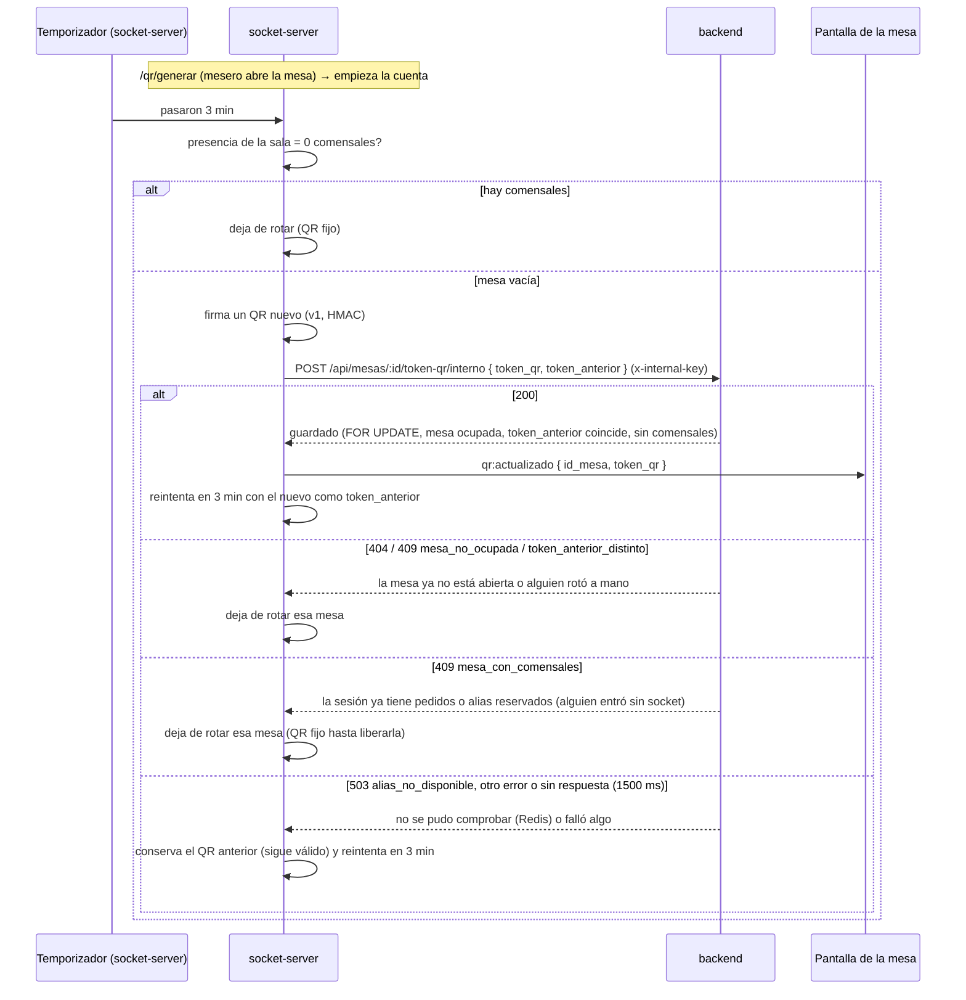

# Rotación automática del QR de mesa

**Regla:** mientras una mesa está abierta (ocupada) y **no hay ningún comensal conectado**, su
QR cambia cada 3 minutos (`ROTACION_QR_MINUTOS`). Con el **primer comensal** en la sala, el QR
queda **fijo** hasta que la mesa se libere.

**Por qué:** entre que el mesero abre la mesa y se sienta el grupo, el QR está a la vista en
la tablet. Quien lo fotografíe podría entrar a esa mesa más tarde. Si el QR rota, esa foto
deja de servir a los 3 minutos. Cuando el grupo ya está sentado, el QR no rota más, para que
los que lleguen después escaneen el mismo.

## Opciones evaluadas

| | A) Temporizador en el socket-server | B) Temporizador en la tablet |
|---|---|---|
| Quién decide si la mesa está vacía | El servidor, con los sockets reales de la sala | La tablet, con `mesa:presencia`… que hoy solo recibe `room:admin` (la pantalla no) |
| Credencial que usa | `INTERNAL_API_KEY`, de servidor a servidor, que ya existe y Nginx bloquea desde fuera | El **JWT de un mesero guardado en la tablet**, a la vista de los comensales (el mismo riesgo que H2) |
| Si nadie tiene el panel abierto | Funciona | Funciona solo si la tablet está despierta y con sesión de personal |
| Confiabilidad del reloj | Temporizador del servidor | El navegador duerme las pestañas inactivas y retrasa los temporizadores |
| Trabajo de otros integrantes | **Un** endpoint pequeño en el backend (Daniel) | Cambios en `frontend-restaurante` (Jarrinson) y un rol nuevo con permisos de rotación |
| Superficie de ataque nueva | Una ruta interna más, solo servidor a servidor | Un token con permisos de personal en un dispositivo público |

**Decisión: A.** Expone menos superficie (ningún secreto ni token de personal sale de los
servidores) y depende de un único endpoint pequeño del backend.

Contras de A que se aceptan:

- El conjunto de mesas que se están rotando vive en memoria del proceso: tras un reinicio, la
  rotación de una mesa vuelve a empezar cuando el personal la abre o rota a mano.
- Con varias instancias del socket-server, cada una rotaría las mesas que abrió. Hoy hay una
  sola instancia; si se escala, conviene un candado en Redis por mesa.

## Flujo



## Contrato del backend (implementado en #168)

Referencia completa: `POST /mesas/:id/token-qr/interno` en
[`backend/docs/api-spec.md`](../../backend/docs/api-spec.md).

```
POST /api/mesas/:id/token-qr/interno
x-internal-key: <INTERNAL_API_KEY>
Content-Type: application/json

{ "token_qr": "v1.<datos>.<firma>", "token_anterior": "v1.<datos>.<firma>" }
```

Lo que hace el backend, en una transacción y con la mesa bloqueada (`FOR UPDATE`):

1. Exige `x-internal-key` con comparación en tiempo constante; sin ella o equivocada, `401`.
2. Valida el cuerpo (`token_qr` y `token_anterior` con forma `v1.<datos>.<firma>`, distintos
   entre sí; `token_anterior` es obligatorio). La firma no la valida: es del socket-server.
3. `404` si la mesa no existe. `409 mesa_no_ocupada` si no está `ocupada`.
4. **Compare-and-swap:** `409 token_anterior_distinto` si `token_anterior` no es el
   `token_qr` vigente (alguien rotó o liberó a mano mientras tanto). **`token_anterior: null`
   también responde `409 token_anterior_distinto`**: no hay cambio a ciegas.
5. **Continuidad:** `409 mesa_con_comensales` si la sesión de mesa ya tiene pedidos o alias
   reservados. Si las reservas de alias no se pueden leer (Redis), `503 alias_no_disponible`.
6. Cambia `mesas.token_qr`, `COMMIT`, y responde `200 { "ok": true }`. **No** llama a
   `/internal/qr-rotado`: el socket-server ya avisa a la tablet cuando recibe el `200`.
7. **Hecho:** el token anterior se guarda en `token_qr_historico`.

Qué hace el rotador con cada respuesta (`src/rotacion.js`):

| Respuesta del backend | Significa | El rotador |
| :--- | :--- | :--- |
| `200 { "ok": true }` | El QR nuevo es el vigente | Emite `qr:actualizado` y vuelve a contar 3 min |
| `400 cuerpo_invalido` | El socket-server mandó un cuerpo mal formado (no debería pasar) | Reintenta en 3 min con el QR anterior y lo deja en el log |
| `401` | `INTERNAL_API_KEY` distinta entre los dos servicios | Reintenta en 3 min y lo deja en el log |
| `404` | La mesa no existe | **Deja de rotar** esa mesa |
| `409 mesa_no_ocupada` | La mesa se liberó | **Deja de rotar** |
| `409 token_anterior_distinto` | Alguien rotó o liberó a mano | **Deja de rotar** (el backend manda) |
| `409 mesa_con_comensales` | Ya entró alguien (pedidos o alias reservados) | **Deja de rotar**: el QR queda fijo hasta liberar la mesa |
| `503 alias_no_disponible` | El backend no pudo comprobar los alias (Redis) | Reintenta en 3 min; el QR anterior sigue valiendo |
| Otro error, sin respuesta o timeout (1500 ms) | — | Reintenta en 3 min; el QR anterior sigue valiendo |

El rotador **nunca** manda `token_anterior: null`. Arranca siempre con el token firmado que
acaba de devolver `/qr/generar`, que es el mismo que el backend guarda al abrir o rotar a mano,
y cada `200` encadena el nuevo como `token_anterior` del ciclo siguiente.

## Continuidad de quienes ya entraron

El socket-server **no revoca** nada al rotar: un comensal que entró con el QR anterior conserva
su socket, su sala y su carrito (cubierto por las pruebas). El backend invalida toda sesión
cuyo `sid` no coincida con el `token_qr` vigente (`sesionDeMesaVigente` en
`auth.middleware.js`), así que rotar dejaría sin sesión a quien escaneó el QR anterior.

Eso ya no pasa: el `409 mesa_con_comensales` cubre a quien ya entró. Todo el que entra por QR
reserva su alias (y el personal reserva el de quien no tiene celular), y cada pedido queda en la
sesión. Con cualquiera de los dos el backend no rota y el QR queda fijo. Esto incluye a quien
escaneó y todavía no abrió su socket, que el socket-server no puede ver.

**Mejora futura, no bloqueante:** guardar el historial de `sid` emitidos desde que la mesa se
abrió y aceptar cualquiera hasta liberarla. Solo hace falta si se quiere que un QR **viejo**
siga valiendo después de rotar, por ejemplo para alguien que escaneó y tardó más de 3 minutos
en escribir su alias. Hoy ese QR viejo deja de servir y basta con volver a escanear la tablet.
